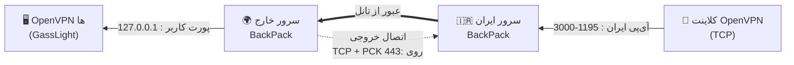

<div align="center">
<h1>OpenVPN</h1>
<h4>⚡GassLight</h4>
</div>

<p align="center">
  <a href="README.fa.md"></a>
  <a href="README.md"></a>
</p>

<p align="center">فارسی | <a href="README.md">English</a></p>

---

> **با یک دستور، یک سرور OpenVPN، یک پنل مدیریت تحت وب و یک پورتال اختصاصی کاربران نصب می‌شود. هر کاربرِ VPN مخصوص خودش را می‌گیرد.**
>
> علاوه بر آن، با دو اسکریپت همراه پروژه می‌توانید **تانل ایران** راه‌اندازی کنید (بدون نیاز به نصب هیچ‌چیز روی سرور ایرانی) و **سرورهای خروجی (Exit Server)** خودتان را در کشورهای مختلف به پنل وصل کنید تا IP خروجی کاربرها را به‌صورت چرخشی تغییر دهد.

گس‌لایت (GassLight) یک سرور تازه‌نصب Ubuntu/Debian را به یک سرویس VPN کامل تبدیل می‌کند که از داخل مرورگر مدیریتش می‌کنید: ساخت کاربر، اختصاص پورت و پروتکل اختصاصی به هر کدام، محدودیت سرعت و حجم و زمان، مشاهده ترافیک زنده و وضعیت CPU/RAM، بکاپ‌گیری و یک صفحه شخصی برای هر کاربر با لینک دانلود قفل‌شده فایل `.ovpn`.

---

## فهرست

- [نصب](#نصب)
- [نصب BackPack Tunnel](#تانل-backpack-برای-gasslight-ایران--خارج)
- [تانل پیشرفته : Overlay Tunnel](https://github.com/MahanAmini/openvpn/blob/main/overlay/README.fa.md)
- [تانل ابتدایی: Setup Tunnel](#تانل-ایران-iran-tunnel-setupsh)
- [سرور خروجی: Setup Exit Servers](#سرور-خروجی-exit-server-setupsh)
- [مسیریابی از طریق پروکسی (Proxy routing)](#مسیریابی-از-طریق-پروکسی-proxy-routing)
- [ویژگی‌ها](#ویژگی‌ها)
- [شیوه کار (معماری)](#شیوه-کار-معماری)
- [پیش‌نیازها](#پیش‌نیازها)
- [پس از نصب](#پس-از-نصب)
- [پنل مدیریت](#پنل-مدیریت)
- [پورتال کاربران](#پورتال-کاربران)
- [خط فرمان: gasslight](#خط-فرمان-gasslight)
- [پورت‌ها و فایروال](#پورت‌ها-و-فایروال)
- [نکات امنیتی و HTTPS](#نکات-امنیتی-و-https)
- [سرورهای خروجی (Exit servers)](#سرورهای-خروجی-exit-servers)
- [آدرس داخل فایل‌های .ovpn](#آدرس-داخل-فایل‌های-ovpn)
- [بروزرسانی و حذف نصب](#بروزرسانی-و-حذف-نصب)
- [عیب‌یابی](#عیب‌یابی)
- [ساختار پروژه](#ساختار-پروژه)
- [حق نشر و لایسنس](#حق-نشر-و-لایسنس)

---

## نصب

این دو دستور را روی سرور (با کاربری که دسترسی `sudo` دارد) اجرا کنید:

```bash
wget https://raw.githubusercontent.com/mahanamini/openvpn/main/install.sh -O install.sh
sudo bash install.sh
```

> ⚠️ **توجه:** اول دانلود کنید، بعد اجرا. از `curl ... | bash` استفاده **نکنید**؛ بخش اصلی OpenVPN چند سؤال می‌پرسد (IP سرور، پروتکل، پورت، DNS، نام اولین کلاینت) و به یک ترمینال واقعی نیاز دارد. برای پذیرش تنظیمات پیش‌فرض Enter بزنید.

نصب‌کننده این کارها را انجام می‌دهد:

1. سیستم را بررسی و فقط بسته‌های کم‌وگمشده را نصب می‌کند.
2. اگر OpenVPN هنوز نصب نیست، هسته آن را نصب می‌کند (به سؤال‌هایش پاسخ می‌دهید).
3. پنل و پورتال را نصب و سرویس‌های systemd آن‌ها را می‌سازد.
4. یک **رمز تصادفی** برای ادمین تولید می‌کند.
5. در صورت فعال بودن `ufw`، پورت‌های پنل و پورتال را باز می‌کند.
6. دستور مدیریتی `gasslight` را نصب کرده و اطلاعات ورود را چاپ می‌کند.

### گزینه‌های نصب

| گزینه | معنی | پیش‌فرض |
|---|---|---|
| `--panel-port N` | پورت پنل مدیریت | `8088` |
| `--portal-port N` | پورت پورتال کاربران | `8089` |
| `--local-only` | پنل فقط روی `127.0.0.1` گوش بدهد (از تونل SSH استفاده کنید) | خاموش |
| `--repo user/repo` | ریپازیتوری گیت‌هاب برای دانلود | ریپوی همین پروژه |
| `--ref NAME` | برنچ یا تگ برای نصب | `main` |
| `-h`, `--help` | نمایش راهنما | |

**مثال:** `sudo bash install.sh --panel-port 9443 --portal-port 9444`

متغیرهای محیطی با همین معنی هم کار می‌کنند: `PANEL_PORT`، `PORTAL_PORT`، `PANEL_HOST`، `GASSLIGHT_REPO`، `GASSLIGHT_REF`.

---

## ویژگی‌ها

### 👑 برای شما (ادمین)

- **نصب با یک دستور** : هسته OpenVPN، پنل، پورتال و یک دستور مدیریت.
- **یک کاربر = یک نمونه OpenVPN**: پورت، پروتکل (TCP یا UDP)، گواهی، تونل و ساب‌نت اختصاصی.
- محدودیت **سرعت**، **حجم روزانه و کلی** و **انقضا بر حسب روز** برای هر کاربر (کاربرهای منقضی‌شده خودکار حذف و گواهیشان باطل می‌شود).
- انتخاب خودکار **ID و پورت** با پرکردن اول شکاف‌های خالی ناشی از حذف کاربرها؛ امکان وارد کردن دستی پورت با بررسی زنده.
- **مانیتورینگ زنده**: سرعت دانلود/آپلود سرور، CPU، RAM و swap، وضعیت آنلاین هر کاربر، IP لوکال VPN، آخرین اتصال و مصرف.
- **بکاپ و بازیابی** همه کاربرها، مصرف و گواهی‌ها در یک فایل zip.
- **چند ادمین**: چندین کاربر پنل، هرکدام با نام کاربری و رمز خودش.
- رابط کاربری فارسی/انگلیسی با یک کلید، تم تیره/روشن، منوی کناری دسکتاپ و منوی موبایل.
- **تغییر IP خروجی** با سه روش: پروکسی‌های عمومی، سرورهای خروجی (SOCKS5) خودتان، و آدرس‌نویسی هوشمند در فایل `.ovpn`.

### 👤 برای کاربران شما

- لینک اختصاصی به یک صفحه شخصی: وضعیت، زمان باقی‌مانده، مصرف، محدودیت‌ها و جزئیات اتصال.
- فایل `.ovpn` پشت یک **رمز دانلود ۸ کاراکتری** قفل است که شما تولید و خودتان برایش می‌فرستید.

---

## شیوه کار (معماری)

```text
                     ┌──────────────────────────── سرور شما ────────────────────────────┐
  کاربر A  ──UDP 1195──►  openvpn-server@alice   tun · 10.101.1.0/24 · گواهی اختصاصی     │
  کاربر B  ──TCP 1196──►  openvpn-server@bob     tun · 10.101.2.0/24 · گواهی اختصاصی     │
  کلاینت‌های قدیمی ─UDP 1194─►  OpenVPN اصلی (هسته مشترک)                                │
                     │                                                                     │
  ادمین   ──TCP 8088──►  پنل گس‌لایت (Flask, root)  ◄── 127.0.0.1 API داخلی ──┐          │
  کاربران ──TCP 8089──►  پورتال کاربران (پردازه جدا، کاربر nobody) ───────────┘          │
                     └─────────────────────────────────────────────────────────────────────┘
```

**یک پورت برای هر کاربر.** OpenVPN در هر پردازه فقط یک پورت سرو می‌دهد، برای همین پنل به‌جای قرار دادن همه در یک کانفیگ مشترک، برای هر کاربر یک نمونه OpenVPN جدا می‌سازد. برای هر کاربر پنل این کارها را می‌کند:

1. یک **گواهی شخصی** (Easy-RSA) و یک فایل `.ovpn` شخصی صادر می‌کند.
2. کانفیگ سرور با **پورت، پروتکل و ساب‌نت /24 یکتا** می‌نویسد و آن را به‌صورت سرویس systemd با نام `openvpn-server@<name>` بالا می‌آورد.
3. آن نمونه را به گواهی همان کاربر محدود می‌کند (`ccd-exclusive`)، پس گواهی یک کاربر نمی‌تواند از پورت کاربر دیگر عبور کند.
4. قوانین فایروال ساب‌نت را اضافه می‌کند (NAT، FORWARD) و در صورت فعال بودن `ufw` پورت را باز می‌کند.
5. یک **سوکت مدیریت (management)** خصوصی باز می‌کند تا پنل شمارنده دقیق و زنده‌ی بایت هر نشست و وضعیت واقعی آنلاین بودن را بخواند.
6. محدودیت سرعت را با `tc` روی تونل همان کاربر اعمال می‌کند (شکل‌دهی دانلود و پلیسینگ آپلود).

به همین دلیل ساخت، ویرایش یا حذف یک کاربر هیچ‌وقت کاربر دیگر را قطع نمی‌کند و مصرف هرکدام جداگانه حساب می‌شود.

**چیزهای مشترک:** IP عمومی سرور، پهنای‌باند، CPU و RAM. کانفیگ هر کاربر روی یک دستگاه هم‌زمان کار می‌کند (اتصال دوم با همان گواهی، اتصال اول را جایگزین می‌کند).

**وضعیت آنلاین و مصرف** از شمارنده‌های خود OpenVPN هر ۲ ثانیه خوانده می‌شود. کاربر فقط وقتی «آنلاین» حساب می‌شود که دستگاهش به سرور داده بفرستد (پنجره ۴۵ ثانیه‌ای)، پس دستگاهی که ناگهان قطع شود «آنلاین» نمی‌ماند.

### معماری تغییر IP خروجی (Proxy Routing و Exit Servers)

هر دو قابلیت روی یک «رله شفاف» داخلی پنل سوارند که این‌طور کار می‌کند:

```text
مرورگر کاربر VPN ──TCP──► سرور پنل ──iptables REDIRECT──► رله محلی (127.0.0.1:8091)
                                                          │
                                                          ├─► پروکسی SOCKS5/4 یا HTTP CONNECT انتخاب‌شده ──► اینترنت
                                                          └─► (فقط اگر fallback فعال باشد) اتصال مستقیم
```

- پنل با قوانین `iptables` در زنجیره `nat`، ترافیک TCP کاربران VPN را (به‌جز ترافیک به خود سرور) به یک **پورت محلی رله** (`8091`) هدایت (REDIRECT) می‌کند.
- رلهِ داخلی پنل (یک TCP server چندنخی به زبان پایتون) اتصال را برمی‌دارد، پروکسی/سرور خروجی را از حالت‌های چرخش (sticky / random / round-robin) انتخاب می‌کند، handshake پروکسی (SOCKS5 با احراز هویت، SOCKS4 یا HTTP CONNECT) را انجام می‌دهد و بعد دوطرفه داده را رد می‌کند.
- این رله **فقط اتصال‌های آمده از ساب‌نت‌های کاربران VPN** را می‌پذیرد؛ کسی از بیرون نمی‌تواند به آن وصل شود و وقتی هیچ‌کدام از دو قابلیت فعال نیست، اصلاً باز نیست.
- **فقط TCP** از پروکسی رد می‌شود؛ UDP (DNS، تماس، بازی) همچنان از خود سرور خارج می‌شود. با گزینه «بستن QUIC»، UDP پورت ۴۴۳ رد می‌شود تا مرورگر به TCP برگردد و از پروکسی عبور کند.
- هر ۳۰ ثانیه سلامت پروکسی‌ها/سرورهای خروجی چک می‌شود تا یکی که قطع شده سریع دور زده شود و یکی که برگشته دوباره وارد چرخش شود.
- نکته مهم: تا وقتی این قابلیت فعال است، **پنل باید بالا بماند**؛ اگر پنل را متوقف کنید، کاربرها اینترنت ندارند تا دوباره بالا بیاید. اگر همه پروکسی‌ها/سرورها خراب باشند و fallback خاموش باشد، اتصال برقرار نمی‌شود.

---

## پیش‌نیازها

| مورد | شرح |
|---|---|
| **سیستم‌عامل** | Ubuntu 22.04+ یا Debian 11+ (با systemd) |
| **دسترسی** | root (`sudo`) |
| **شبکه** | یک IP عمومی، دستگاه TUN فعال (`/dev/net/tun`) |
| **منابع** | برای شروع ۵۱۲ مگابایت RAM کافی است؛ هر نمونه کاربر حدود ۱۰ تا ۲۰ مگابایت مصرف می‌کند |
| **فایروال ابری** | باید پورت‌های فهرست‌شده در [پورت‌ها و فایروال](#پورت‌ها-و-فایروال) را باز کنید |

---

## پس از نصب

در انتهای نصب چیزی شبیه این چاپ می‌شود:

```text
 Panel     :  http://YOUR_SERVER_IP:8088
 Username  :  gasslight
 Password  :  <۱۶ کاراکتر تصادفی>
 Portal    :  http://YOUR_SERVER_IP:8089
```

| جزئیات | توضیح |
|---|---|
| **نام کاربری پیش‌فرض** | `gasslight` |
| **رمز** | تصادفی، هنگام نصب تولید و **فقط یک بار** نمایش داده می‌شود — آن را ذخیره کنید |
| **فراموش کردید؟** | `sudo gasslight reset-password` یک رمز جدید چاپ می‌کند |
| **تغییر رمز** | پنل → **پیشرفته → حساب من** (هم نام کاربری و هم رمز را می‌توانید عوض کنید) |

### شروع سریع:

1. `http://YOUR_SERVER_IP:8088` را باز کنید و وارد شوید.
2. پورت‌های فایروال ابری را باز کنید (بخش [پورت‌ها و فایروال](#پورت‌ها-و-فایروال)).
3. **داشبورد → ساخت کاربر جدید**، نام، پروتکل و محدودیت‌ها را انتخاب و *Create* را بزنید.
4. روی کارت کاربر جدید دکمه **Copy link** را بزنید و لینک را به‌همراه **رمز دانلود** (روی همان کارت نمایش داده می‌شود) برای کاربر بفرستید.

اولین کلاینت VPN که هنگام نصب هسته OpenVPN ساخته می‌شود در `/root/<name>.ovpn` ذخیره می‌شود و می‌توانید از داشبورد آن را به پورت خودش منتقل کنید (بخش *افزودن کلاینت‌های موجود* در پایین).

---

## پنل مدیریت

### داشبورد

- **کارت‌های خلاصه**: تعداد کل کاربرها، کاربرهای فعال، کاربرهای نزدیک انقضا (کمتر از ۳ روز)، کاربرهای بدون انقضا.
- **ساخت کاربر جدید**

  | فیلد | جزئیات |
  |---|---|
  | ID | به‌صورت خودکار (کمترین عدد آزاد) |
  | نام | حروف انگلیسی، عدد، `-` و `_`، حداکثر ۳۲ کاراکتر |
  | پروتکل | **UDP** یا **TCP** |
  | پورت | خودکار (کمترین پورت آزاد بالای 1194) یا **دستی**، با بررسی زنده؛ پورت‌های 22، 1194 و پورت پنل رزرو هستند |
  | مدت (روز) | `0` = نامحدود، حداکثر 3650؛ کاربر منقضی‌شده خودکار حذف می‌شود |
  | حداکثر سرعت (Mbps) | `0` = نامحدود؛ برای دانلود و آپلود اعمال می‌شود |
  | سقف روزانه (GB) | `0` = بدون سقف؛ با رسیدن به آن کاربر تا اول روز بعد (به‌وقت سرور) مسدود می‌شود |
  | سقف کلی (GB) | `0` = بدون سقف؛ با رسیدن به آن تا وقتی سقف را بالا ببرید یا مصرفش را ریست کنید مسدود می‌ماند |

- **کارت‌های کاربرها** وضعیت، ID، پورت، پروتکل، سرعت و محدودیت‌ها، زمان باقی‌مانده (با نوار پیشرفت)، مصرف و این عملیات‌ها را نشان می‌دهند:

  | عملیات | کاری که می‌کند |
  |---|---|
  | **Download .ovpn** | دانلود فایل کانفیگ کاربر |
  | **Edit** | تغییر ID، پورت، پروتکل، سرعت و سقف‌ها؛ اگر کانفیگ جدید بالا نیاید، به‌طور خودکار به تنظیمات قبلی برمی‌گردد. بعد از تغییر ID، پورت یا پروتکل، فایل `.ovpn` قدیمی از کار می‌افتد — فایل جدید را بفرستید |
  | **Extend** | اضافه‌کردن روز به انقضا |
  | **Remove expiry** | نامحدود کردن کاربر از نظر زمان |
  | **Reset usage** | صفر کردن شمارنده‌های مصرف (داخل دیالوگ Edit) |
  | **Delete** | توقف سرویس، حذف فایل‌ها و قوانین فایروال و باطل کردن گواهی |
  | **Download password / Copy link / Open page / New password / New link** | مدیریت دسترسی کاربر به پورتال |

- **جستجو** در کاربرها بر اساس نام یا پورت.
- **افزودن کلاینت‌های موجود**: کلاینت‌هایی که با نصب‌کننده اصلی OpenVPN روی پورت اصلی ساخته شده‌اند را می‌توانید به یک نمونه جدا با پورت خودش منتقل کنید. همان گواهی قبلی استفاده می‌شود، پس فایل قدیمی روی پورت 1194 هم کار می‌کند.

### مصرف شبکه (Network Usage)

مانیتورینگ زنده سرور که هر ثانیه به‌روز می‌شود:

- سرعت دانلود و آپلود (با نمودار زنده ۳ دقیقه‌ای)،
- **CPU** (مصرف، تعداد هسته‌ها، load average) و **RAM** (مصرف/کل، swap) با گیج و نمودار،
- ترافیک امروز، این ماه، از زمان بوت و پیک ۳ دقیقه اخیر.

### مصرف کاربران (User Usage)

یک کارت برای هر کاربر که هر ۲ ثانیه به‌روز می‌شود:

- **آنلاین/آفلاین**، **IP لوکال VPN** (مثلاً `10.101.1.2`)، **آخرین اتصال**،
- تاریخ ساخت، دانلود، آپلود، مجموع و مصرف امروز،
- نوار پیشرفت سقف‌های روزانه و کلی، سهم از ترافیک کل، سرعت لحظه‌ای.

### بکاپ

- **ساخت بکاپ**: دانلود یک zip شامل همه کاربران و تنظیمات، مجموع مصرف و کل گواهی‌ها و کلیدها.
- **بازیابی بکاپ**: کاربران را از چنین فایلی برمی‌گرداند. کاربرانی که اسمشان وجود دارد رد می‌شوند، ID/پورت در صورت آزاد بودن حفظ می‌شود (وگرنه نزدیک‌ترین مقدار آزاد) و کاربران منقضی‌شده رد می‌شوند. فایل‌های `.ovpn` با آدرس همین سرور دوباره ساخته می‌شوند، پس برای **انتقال به سرور جدید** هم کار می‌کند. اگر بکاپ با CA متفاوتی ساخته شده، باید تیک **بازگردانی گواهی‌ها** را بزنید؛ پیش از آن یک نسخه امن از گواهی‌های فعلی ذخیره می‌شود.
- لینک‌های پورتال و رمزهای دانلود در بکاپ حفظ می‌شوند.

> 🔒 بکاپ شامل **کلیدهای خصوصی** (از جمله کلید CA) است. آن را در جای امنی نگه دارید.

### پیشرفته (Advanced)

اینجا سه قابلیت جدید پنل و تنظیمات حساب قرار دارد:

| زیرصفحه | توضیح |
|---|---|
| **My account** | تغییر نام کاربری و رمز خودتان؛ افزودن/حذف ادمین‌های دیگر |
| **Proxy routing** | مسیریابی TCP کاربران از داخل پروکسی‌های SOCKS4/5 یا HTTP |
| **Exit servers & .ovpn address** | سرورهای خروجی SOCKS5 خودتان + آدرس نوشته‌شده داخل فایل‌های `.ovpn` |

این سه بخش در [ادامه فایل](#مسیریابی-از-طریق-پروکسی-proxy-routing) کامل توضیح داده شده‌اند.

### رابط کاربری

به‌طور پیش‌فرض انگلیسی؛ دکمه **فارسی** با چیدمان راست‌به‌چپ، تم تیره/روشن خودکار، منوی کناری در دسکتاپ و منوی کشویی در موبایل.

---

## پورتال کاربران

هر کاربر یک لینک خصوصی دارد، مثلاً `http://YOUR_SERVER_IP:8089/u/<توکن-تصادفی-بلند>`. از کارت کاربر در پنل کپی کنید. صفحه (فارسی یا انگلیسی، قابل تعویض) این‌ها را نشان می‌دهد:

- وضعیت آنلاین/آفلاین، آخرین اتصال و IP لوکال VPN،
- آدرس سرور، پروتکل، پورت و محدودیت سرعت،
- تاریخ ساخت، تاریخ انقضا و زمان باقی‌مانده،
- دانلود، آپلود، مجموع و مصرف امروز به‌همراه سقف‌ها،
- **دانلود قفل‌شده** فایل `.ovpn`: کاربر باید **رمز دانلود** را وارد کند.

**رمز دانلود:** هر کاربر یک رمز تصادفی ۸ کاراکتری می‌گیرد (حروف بزرگ و کوچک، عدد و علامت؛ کاراکترهای مشابه مثل `0/O` و `1/l` حذف شده‌اند) که پنل تولید و روی کارتش نشان می‌دهد. آن را خودتان، از هر کانالی که می‌خواهید، برای کاربر می‌فرستید. هم رمز و هم لینک را هر وقت بخواهید می‌توانید از نو بسازید؛ قبلی‌ها بی‌درنگ از کار می‌افتند.

**محافظت:** بعد از ۵ رمز اشتباه، لینک ۵ دقیقه قفل می‌شود و بعد از ۱۲ تلاش اشتباه از یک IP، آن IP برای ۱۰ دقیقه قفل می‌شود. پورتال به‌صورت یک پردازه کم‌امتیاز جدا (کاربر `nobody`) روی پورت خودش اجرا می‌شود، هیچ داده و کلیدی نگه نمی‌دارد و فقط از طریق API داخلی محلی (فقط localhost) و با یک رمز مشترک با پنل حرف می‌زند.

---

## خط فرمان: gasslight

نصب‌کننده این دستور مدیریتی را اضافه می‌کند:

| دستور | کاری که می‌کند |
|---|---|
| `gasslight info` | نشان دادن آدرس پنل و پورتال |
| `gasslight status` | وضعیت سرویس‌های پنل و پورتال |
| `gasslight restart` | ری‌استارت پنل و پورتال |
| `gasslight logs [N]` | N خط آخر لاگ (پیش‌فرض ۱۰۰) |
| `gasslight reset-password [user]` | تنظیم رمز تصادفی جدید (پیش‌فرض برای `gasslight`) و چاپ آن |
| `gasslight update` | بروزرسانی به آخرین نسخه از گیت‌هاب (داده‌ها حفظ می‌شوند) |
| `gasslight uninstall [--purge]` | حذف پنل و پورتال؛ `--purge` داده‌های پنل را هم پاک می‌کند |

بیشتر دستورها به `sudo` نیاز دارند.

نام سرویس‌های مفید: `ovpn-panel` (پنل)، `gasslight-portal` (پورتال)، `openvpn-server@<username>` (یکی برای هر کاربر).

---

## پورت‌ها و فایروال

این پورت‌ها را در **فایروال ابری ارائه‌دهنده** (و در `ufw` در صورت استفاده؛ نصب‌کننده پورت‌های پنل و پورتال را در `ufw` باز می‌کند) باز کنید:

| پورت | پروتکل | کاربرد |
|---|---|---|
| 8088 | TCP | پنل مدیریت (یا پورتی که انتخاب کردید) |
| 8089 | TCP | پورتال کاربران (یا پورتی که انتخاب کردید) |
| 1194 | UDP | OpenVPN اصلی (یا پورتی که هنگام نصب انتخاب کردید) |
| پورت هر کاربر | UDP یا TCP | یک پورت برای هر کاربر — بازه‌ای که می‌خواهید استفاده کنید را باز کنید، مثلاً `1195–1299` |

> پورت رله محلی (`8091`) را **نباید** باز کنید؛ او فقط به ترافیک داخلی کاربران VPN پاسخ می‌دهد و به‌هیچ‌وجه برای بیرون قابل استفاده نیست.

---

## نکات امنیتی و HTTPS

- پنل به‌طور پیش‌فرض با دسترسی root و HTTP ساده اجرا می‌شود. از یک **رمز قوی** استفاده کنید و ترجیحاً `--local-only` را با تونل SSH (`ssh -L 8088:127.0.0.1:8088 user@SERVER`) فعال کنید یا آن را پشت یک پروکسی معکوس HTTPS بگذارید.
- برای سرو کردن پورتال روی HTTPS از یک دامنه، آن را پشت پروکسی معکوس (مثلاً Caddy یا Nginx) بگذارید و آدرس عمومی را به پنل بدهید تا لینک‌های کپی‌شده درست باشند:

  ```bash
  sudo systemctl edit ovpn-panel
  ```
  ```ini
  [Service]
  Environment=PORTAL_BASE_URL=https://vpn.example.com
  ```
  و برای پورتال پشت پروکسی خودتان:
  ```bash
  sudo systemctl edit gasslight-portal
  ```
  ```ini
  [Service]
  Environment=TRUST_PROXY=1
  ```
  بعد `sudo gasslight restart`. (تنظیمات `systemctl edit` هنگام بروزرسانی حفظ می‌شوند.)
- رمزهای ادمین به‌صورت hash ذخیره می‌شوند. **رمزهای دانلود کاربران به‌صورت متن ساده** در پوشه داده پنل نگه داشته می‌شوند (تا بتوانید آن‌ها را ببینید)؛ این پوشه فقط برای root قابل خواندن است. بکاپ‌ها شامل کلیدهای خصوصی هستند.
- داده‌های پنل در `/opt/ovpn-panel` (پرمیشن `700`) قرار دارند.

---

<div dir="rtl">

## تانل BackPack برای GassLight (ایران ⇄ خارج)

کاربرها به **سرور ایران** وصل می‌شوند و [BackPack](https://github.com/AminMGMT/BackPack) ترافیکشان را به **سرور اصلی (خارج)** که GassLight / OpenVPN روی آن اجرا می‌شود می‌رساند. کاربر هیچ‌وقت IP سرور اصلی را نمی‌بیند و تانل از نوع **reverse** است: سرور خارج به ایران وصل می‌شود، پس **به پورت ورودیِ باز برای تانل نیاز ندارد**.

<div dir="ltr">



</div>

**فهرست:** [مسیر سریع](#bp-quick) · [1. آماده‌سازی سرور خارج](#bp-1) · [2. نصب BackPack](#bp-2) · [3. سرور ایران](#bp-3) · [4. سرور خارج](#bp-4) · [5. پنل GassLight](#bp-5) · [6. بررسی](#bp-6) · [نکته‌ها](#bp-tips) · [عیب‌یابی](#bp-trouble) · [دستورها](#bp-cmds)

---

<a id="bp-quick"></a>

### مسیر سریع

| گام | سرور | کار |
|---|---|---|
| 1 | 🌍 خارج (اصلی) | اجرای ‎`ovpn-autopatch-setup.sh` تا OpenVPN به اتصال‌های ‎`127.0.0.1` هم جواب بدهد |
| 2 | 🇮🇷 + 🌍 | نصب BackPack روی هر دو سرور |
| 3 | 🇮🇷 ایران | ‎`sudo backpack` ← Setup Iran (Reverse، TCP + PCK، پورت ‎`443`، پورت‌های فوروارد ‎`1195-3000`) ← **لینک Setup** رو کپی کن |
| 4 | 🌍 خارج | ‎`sudo backpack` ← Setup Kharej ← لینک رو پیست کن |
| 5 | 🌍 پنل GassLight | Advanced ← *Address inside .ovpn files* = **آی‌پی ایران**؛ کاربرها رو با **TCP** بساز |

> **همیشه اول سرور ایران رو تنظیم کن.** سمت خارج به لینک (آدرس، پورت تانل و توکن) نیاز داره که سمت ایران می‌سازه.

---

<a id="bp-1"></a>

### 1. آماده‌سازی سرور خارج

پنل کانفیگ هر کاربر رو از ‎`server.conf` اسکریپت Nyr می‌سازه و توش ‎`local <IP>` هست، یعنی OpenVPN **فقط** روی همون آدرس گوش می‌ده. BackPack ترافیک رو به ‎`127.0.0.1:<port>` روی سرور خارج می‌ده و اتصال رد می‌شه. اسکریپت زیر اون خط رو کامنت می‌کنه (‎`#local`) تا OpenVPN روی localhost هم گوش بده. آدرس عمومی مثل قبل کار می‌کنه.

روی **سرور خارج (اصلی)** بزن. اسکریپت رو دانلود می‌کنه و همون لحظه اجرا می‌کنه:

<div dir="ltr">

```bash
curl -fsSL https://raw.githubusercontent.com/MahanAmini/openvpn/main/backpack/ovpn-autopatch-setup.sh -o ovpn-autopatch-setup.sh && sudo bash ovpn-autopatch-setup.sh
```

</div>

یه سرویس کوچیک (‎`ovpn-autopatch`) هم نصب می‌کنه که کانفیگ‌هایی که بعداً ساخته می‌شن رو هم درست می‌کنه. کاربرهای وصل‌شده **یک‌بار** ری‌استارت می‌شن (چند ثانیه، کلاینت خودش دوباره وصل می‌شه). برای جلوگیری از این قطعی ‎`--no-restart` اضافه کن (به کاربرها دست نمی‌زنه، ولی سرویس پچ‌شده بعد از ری‌استارت بعدیش روی localhost گوش می‌ده). گزینه‌های بیشتر [آخر همین فایل](#bp-cmds) هست.

چک کن کار کرده (باید ‎`0.0.0.0:<port>` ببینی، نه یه آدرس IP):

<div dir="ltr">

```bash
sudo ss -lntp | grep 1195      # کاربر TCP
sudo ss -lnup | grep 1195      # کاربر UDP
```

</div>


<a id="bp-2"></a>

### 2. نصب BackPack روی هر دو سرور

روی سرور **ایران** و **خارج** (با root):

<div dir="ltr">

```bash
curl -fsSL https://raw.githubusercontent.com/AminMGMT/BackPack/main/install.sh | sudo bash
```

</div>

یا

<div dir="ltr">

```bash
bash <(curl -fsSL https://raw.githubusercontent.com/AminMGMT/BackPack/main/install.sh)
```

</div>

بعد منو رو باز کن:

<div dir="ltr">

```bash
sudo backpack
```

</div>

PCK (ترنسپورتی که اینجا استفاده می‌شه) روی هر دو سر **لینوکس و root** می‌خواد.

---

<a id="bp-3"></a>

### 3. تنظیم سرور ایران

<div dir="ltr">

```bash
sudo backpack
```

</div>

| سؤال | جواب |
|---|---|
| منوی اصلی | ‎`1` **Setup Iran** |
| جهت | ‎`1` **Reverse** |
| خانواده‌ی ترنسپورت | ‎`1` **TCP** |
| نوع TCP | ‎`4` **TCP + PCK** |
| آی‌پی یا دامنه‌ی ایران | **Enter** (همون که تشخیص داده) |
| پورت تانل | ‎`443` |
| Listen on IPv6 as well | ‎`n` |
| پورت‌های فوروارد | ‎`1195-3000` |
| بقیه‌ی سؤال‌ها | **Enter** برای پیش‌فرض، ‎`n` برای هر سؤال بله/خیر |

جواب‌هایی که اگه ویزارد بپرسه خوبه بدونی:

| سؤال | جواب | چرا |
|---|---|---|
| Tunnel name | Enter | فقط یه برچسبه (اسم سرویس ‎`backpack-<name>` رو می‌سازه) |
| Security token | Enter | یه توکن ۶۴ کاراکتری خودش می‌سازه |
| Carry UDP as well as TCP | ‎`n` | کاربرها با **TCP** وصل می‌شن. فقط اگه کاربر UDP هم داری ‎`y` بزن |
| Enable PROXY protocol | ‎`n` | OpenVPN اون رو نمی‌فهمه و ‎`y` همه‌ی اتصال‌ها رو خراب می‌کنه |
| سؤال‌های مخصوص PCK | Enter | پیش‌فرض‌ها خوبن |
| Performance preset | Enter (Turbo) | پیش‌فرض پیشنهادی |
| Fine-tune by hand | ‎`n` | پریست همه‌چی رو تنظیم کرده |

آخر کار، قبل از **Create This Tunnel**، ویزارد یه **Setup Link** (‎`backpack://…`) چاپ می‌کنه. تانل رو بساز و **لینک رو کپی کن**.

> متن و ترتیب سؤال‌ها بین نسخه‌های BackPack ممکنه کمی فرق کنه. قاعده همونه: Enter برای پیش‌فرض، ‎`n` برای بله/خیر، و مقدارهای جدول اول.

فایروال سرور ایران (و security group ارائه‌دهنده) رو باز کن:

<div dir="ltr">

```bash
sudo ufw allow 443/tcp          # پورت تانل
sudo ufw allow 1195:3000/tcp    # پورت‌های فوروارد کاربرها
```

</div>

> **رنج باید پورت کاربرها رو بپوشونه.** GassLight به کاربرها از پورت **1195** به بالا پورت می‌ده. رنجی که از عدد بالاتری شروع بشه، پورت‌های پایین‌تر رو بی‌پاسخ می‌ذاره. پورت تانل (‎`443`) رو بیرون از رنج نگه دار.

---

<a id="bp-4"></a>

### 4. تنظیم سرور خارج

<div dir="ltr">

```bash
sudo backpack
```

</div>

| سؤال | جواب |
|---|---|
| منوی اصلی | ‎`2` **Setup Kharej** |
| جهت | ‎`1` **Reverse** |
| خانواده‌ی ترنسپورت | ‎`1` **TCP** |
| روش اتصال | ‎`1` **Setup Link** |
| ترنسپورت | ‎`4` **TCP + PCK** (همون ایران) |
| لینک | Setup Link سرور ایران رو پیست کن |
| بقیه‌ی سؤال‌ها | **Enter** برای پیش‌فرض، ‎`n` برای بله/خیر |

«Configure optional connection settings» (پروکسی خروجی، اتصال به یه اینترفیس خاص، آدرس‌های پشتیبان) ← ‎`n`.

**راه سریع‌تر:** زیر Setup Link ویزارد ایران یه خط دیگه هم چاپ می‌کنه. اون رو با root روی سرور خارج بزن: BackPack رو نصب می‌کنه، تانل رو از روی لینک می‌سازه و استارت می‌کنه:

<div dir="ltr">

```bash
bash <(curl -fsSL https://raw.githubusercontent.com/AminMGMT/BackPack/main/install.sh) link apply 'backpack://…'
```

</div>

اگه BackPack از قبل نصبه: ‎`sudo backpack link apply 'backpack://…'`.

---

<a id="bp-5"></a>

### 5. وصل کردن پنل GassLight به ایران

تو پنل **اصلی** GassLight: **Advanced ← Address inside .ovpn files** ← **IP سرور ایران** رو وارد کن. از این به بعد همه‌ی فایل‌های ‎`.ovpn` (و پرتال کاربر) به ایران وصل می‌شن. کاربرها باید کانفیگشون رو دوباره دانلود کنن.

موقع ساخت یا ویرایش کاربر، پروتکل **TCP** رو انتخاب کن. مطمئن شو پورت کاربر (ستون *Port*) تو رنج فوروارد هست.

---

<a id="bp-6"></a>

### 6. چک کردن اینکه کار می‌کنه

روی سرور خارج:

<div dir="ltr">

```bash
sudo backpack tunnel status NAME
```

</div>

باید ‎`state online` و یه ‎`last hop` بدون ‎`refused` ببینی. وقتی کلاینت وصل بشه، ‎`carried` بالا می‌ره. برای نمای زنده: ‎`sudo backpack ← 3. Manage ← Status`، و ‎`Manage ← Health Check` مشکل‌ها رو پیدا می‌کنه و راه‌حل می‌نویسه.

تست نهایی: یه کلاینت OpenVPN رو به ‎`IRAN_IP:<port>` وصل کن و ببین کاربر تو پنل GassLight **آنلاین** می‌شه. قبل از اینکه همه رو منتقل کنی با یه کاربر تست کن.

---

<a id="bp-tips"></a>

### نکته‌ها

- **کاربرها روی TCP.** پورت‌های فوروارد پیش‌فرض TCP حمل می‌کنن؛ UDP یه تنظیم اضافه‌ی جدا برای هر تانل هست (*Carry UDP*) و سربار بیشتری داره. OpenVPN روی TCP داخل یه تانل TCP تو مسیر پرافت ممکنه کند بشه؛ اگه دیدی، *Carry UDP* رو ‎`y` کن و به اون کاربرها UDP بده، یا ترنسپورت دیگه‌ای امتحان کن (‎`Manage ← Link Test` مسیرت رو می‌سنجه و پیشنهاد می‌ده).
- **دو سر باید یکی باشن:** همون ترنسپورت و همون توکن. توکن اشتباه شبیه تانل مرده دیده می‌شه.
- **TCP + PCK** برای مسیرهاییه که TCP ساده وصل می‌شه ولی بعدش گیر می‌کنه، reset می‌شه یا throttle می‌شه. اگه روی مسیر تو جواب نداد، TCP، TCP + Stealth یا TCP Mux رو امتحان کن.
- **انتقال‌های بزرگ گیر می‌کنه ولی تانل سالم به نظر می‌رسه؟** ‎`Manage ← Health Check` رو بزن؛ MTU مسیر رو اندازه می‌گیره.
- **بعد از اجرای دوباره‌ی اسکریپت Nyr** ممکنه خط ‎`local` برگرده. پچ‌کننده‌ی خودکار ظرف چند ثانیه درستش می‌کنه.
- **سخت‌گیری اختیاری:** وقتی همه‌چی کار کرد، کاربرها فقط به تانل نیاز دارن. می‌تونی پورت‌های کاربرها (‎`1195-3000`) رو از اینترنت روی سرور خارج ببندی. SSH و پورت پنل رو باز نگه دار.
- **فایل‌های ‎`.ovpn` قدیمی** هنوز مستقیم به سرور خارج اشاره می‌کنن و تا وقتی اون پورت‌ها باز باشن کار می‌کنن.
- لینک Setup و توکن رو محرمانه نگه دار. با ‎`Maintenance ← Backup` بکاپ بگیر.

---

<a id="bp-trouble"></a>

### عیب‌یابی

| چی می‌بینی | دلیل محتمل | راه‌حل |
|---|---|---|
| ‎`state online` ولی ‎`127.0.0.1:PORT … refused` | OpenVPN به یه IP bind شده (‎`local`)، یا هیچ کاربری از اون پورت استفاده نمی‌کنه | پچ‌کننده رو اجرا کن (گام 1). اگه کاربری اون پورت رو نداره، فقط یه اسکنر به رنج باز خورده و بی‌خطره |
| ‎`state offline` | توکن یا پورت تانل اشتباهه، یا فایروال ایران بسته‌ست | توکن دو سر رو چک کن، ‎`ufw allow 443/tcp`، security group ارائه‌دهنده |
| وصل می‌شه ولی گیر می‌کنه یا reset می‌شه | مسیر TCP ساده رو throttle می‌کنه، یا مشکل MTU | ‎`Manage ← Health Check`، ترنسپورت دیگه‌ای امتحان کن |
| کاربرهای UDP وصل نمی‌شن | UDP حمل نمی‌شه | تانل رو با *Carry UDP* = ‎`y` ویرایش یا دوباره بساز، یا کاربرها رو TCP کن |
| همه‌ی اتصال‌ها خراب می‌شه | PROXY protocol روشنه | خاموشش کن (‎`n`) |
| بعضی کاربرها وصل نمی‌شن | رنج فوروارد کوچیک‌تر از پورت کاربرهاست | پورت‌های تانل رو به ‎`1195-3000` ویرایش کن |

---

<a id="bp-cmds"></a>

### دستورها

#### ‎`ovpn-autopatch-setup.sh`

<div dir="ltr">

```bash
curl -fsSL https://raw.githubusercontent.com/MahanAmini/openvpn/main/backpack/ovpn-autopatch-setup.sh -o ovpn-autopatch-setup.sh && sudo bash ovpn-autopatch-setup.sh
```

</div>

| دستور | کارکرد |
|---|---|
| ‎`sudo bash ovpn-autopatch-setup.sh` | همه‌ی ‎`/etc/openvpn/server/*.conf` رو پچ می‌کنه، فقط سرویس‌های روشنِ تغییرکرده رو ری‌استارت می‌کنه و سرویس ‎`ovpn-autopatch` رو نصب می‌کنه |
| ‎`sudo bash ovpn-autopatch-setup.sh --no-restart` | فقط فایل‌ها رو عوض می‌کنه؛ هیچ سرویسی ری‌استارت نمی‌شه |
| ‎`sudo bash ovpn-autopatch-setup.sh --once` | همین الان پچ می‌کنه و تموم (بدون سرویس پس‌زمینه) |
| ‎`sudo bash ovpn-autopatch-setup.sh --uninstall` | سرویس و اسکریپت رو حذف می‌کنه (خط‌های ‎`#local` کامنت می‌مونن) |
| ‎`sudo bash ovpn-autopatch-setup.sh --help` | راهنما |
| ‎`sudo systemctl status ovpn-autopatch` | وضعیت سرویس |
| ‎`sudo systemctl restart ovpn-autopatch` | ری‌استارت سرویس |
| ‎`sudo systemctl disable --now ovpn-autopatch` | توقف و حذف از بوت |
| ‎`journalctl -u ovpn-autopatch -n 20 --no-pager` | آخرین خط‌های لاگ |
| ‎`grep -H '^local' /etc/openvpn/server/*.conf` | کانفیگ‌هایی که هنوز به یه IP bind هستن (خروجی خالی = درسته) |
| ‎`sudo ss -lntp \| grep 1195` | پورت TCP کاربر روی چه آدرسی گوش می‌ده |
| ‎`sudo ss -lnup \| grep 1195` | همین برای UDP |

#### BackPack

| دستور | کارکرد |
|---|---|
| ‎`sudo backpack` | باز کردن منو (1 Setup Iran، 2 Setup Kharej، 3 Manage، …) |
| ‎`sudo backpack tunnel status NAME` | وضعیت، last hop، ترافیک و uptime یه تانل |
| ‎`sudo backpack link apply '<link>'` | ساخت سمت خارجِ تانل از روی لینک Setup |
| ‎`Manage ← Status` | جدول زنده‌ی تانل‌ها |
| ‎`Manage ← Health Check` | پیدا کردن مشکل و چاپ راه‌حل |
| ‎`Manage ← Link Test` | سنجش مسیر و پیشنهاد ترنسپورت |
| ‎`Maintenance ← Backup` | بکاپ تنظیمات BackPack |

بیشتر: [مستندات BackPack](https://github.com/AminMGMT/BackPack) · [آموزش TCP](https://github.com/AminMGMT/BackPack/blob/main/tutorial/tcp.md)

</div>


## تانل ساده: iran-tunnel-setup.sh

این اسکریپت روی **سرور ایران** اجرا می‌شود و همه چیزی که روی پورت‌های مشخص به این سرور می‌رسد (UDP + TCP) را دست‌نخورده به سرور خارجی (جایی که OpenVPN و پنل نصب است) رد می‌کند. هیچ‌چیز اینجا رمزگشایی یا بررسی نمی‌شود؛ این سرور فقط **حامل** است. رمزنگاری بین کاربر و سرور خارجی باقی می‌ماند.

```text
      کاربر  --->  سرور ایران (این اسکریپت)  --->  سرور خارج
```

### اجرا

روی سرور ایران به‌عنوان root:

```bash
wget https://raw.githubusercontent.com/mahanamini/openvpn/main/scripts/iran-tunnel-setup.sh -O iran-tunnel-setup.sh
sudo bash iran-tunnel-setup.sh --to Panel-IP --ports 1194:3000
```

### گزینه‌ها

| گزینه | معنی |
|---|---|
| `--to IP` | آی‌پی سرور خارجی (**الزامی**) |
| `--ports LIST` | پورت‌هایی که جابه‌جا می‌شوند، بازه مجاز، با ویرگول جدا، حداکثر ۱۵ مورد (پیش‌فرض `1194:3000` — پنل از 1195 به بعد پورت می‌دهد) |
| `--status` | نمایش وضعیت فعلی و تعداد بسته‌های منتقل‌شده |
| `--uninstall` | حذف کامل تانل |
| `-h`, `--help` | راهنما |

### شیوه کار (معماری اسکریپت)

اسکریپت یک سرویس systemd با نام `gl-tunnel` می‌سازد که این قوانین `iptables` را اعمال می‌کند و بعد از ری‌استارت/ریبوت دوباره خودش بالا می‌آید:

- **DNAT** در `PREROUTING`: هر بسته UDP/TCP که مقصدش یکی از پورت‌های بازه است، بدون بازکردن و تغییر، به آی‌پی سرور خارجی می‌افتد (پورت حفظ می‌شود).
- **MASQUERADE** در `POSTROUTING`: آی‌پی مبدأ بسته به آی‌پی سرور ایران تغییر می‌کند تا پاسخ سرور خارجی به همان مسیری که آمده برگردد.
- **ACCEPT در `FORWARD`**: عبور این بسته‌ها و پاسخ‌های مرتبط (ESTABLISHED,RELATED) مجاز می‌شود.
- **IP forwarding** فعال می‌شود (`net.ipv4.ip_forward = 1` در `sysctl.d` برای ماندگاری بعد از ریبوت).

### محافظت‌های داخلی اسکریپت

- اگر بازه پورت‌ها شامل **پورت ۲۲ (SSH)** باشد، اجرا متوقف می‌شود تا خودتان را قفل نکنید.
- **پورت SSH جلسه فعلی** (از `SSH_CONNECTION` خوانده می‌شود) هم بررسی می‌شود؛ اگر بازه شامل آن باشد، اجرا متوقف می‌شود.
- اگر سرویسی روی این سرور روی یکی از پورت‌های بازه در حال Listen باشد، هشدار می‌دهد که آن سرویس از دسترس خارج می‌شود (چون ترافیک به سرور خارجی می‌رود).

### بعد از اجرا

1. پورت‌های همان بازه را (UDP و TCP) در فایروال / پنل ارائه‌دهنده سرور ایران باز کنید.
2. در پنل، بخش **پیشرفته → آدرس .ovpn** را باز کنید و آی‌پی سرور ایران را وارد کنید (راهنمای کامل در [این بخش](#آدرس-داخل-فایل‌های-ovpn)).
3. هر وقت بخواهید وضعیت را ببینید: `sudo bash iran-tunnel-setup.sh --status` — تعداد بسته‌های منتقل‌شده به سمت سرور خارجی را نشان می‌دهد (اگر همه صفر باشد یعنی هنوز کسی وصل نشده).
4. حذف: `sudo bash iran-tunnel-setup.sh --uninstall`

---

## سرور خروجی: exit-server-setup.sh

این اسکریپت روی **سرورهای خارجی شما** (آلمان، هلند، فرانسه و...) اجرا می‌شود و یک **پروکسی SOCKS5 با نام‌کاربری و رمز** بالا می‌آورد تا در بخش [سرورهای خروجی](#سرورهای-خروجی-exit-servers) پنل واردش کنید. روی سرور پنل اجرا نشود.

### اجرا

```bash
wget https://raw.githubusercontent.com/mahanamini/openvpn/main/scripts/exit-server-setup.sh -O exit-server-setup.sh
sudo bash exit-server-setup.sh --allow-ip Panel-IP [--port 1080] [--user NAME] [--pass PASSWORD]


port, user, password are optional
```

### گزینه‌ها

| گزینه | معنی |
|---|---|
| `--allow-ip IP[,IP2]` | فقط این آی‌پی‌ها (سرور پنل) اجازه اتصال دارند. **به‌شدت توصیه می‌شود.** |
| `--port N` | پورت پروکسی (پیش‌فرض 1080) |
| `--user NAME` | نام کاربری پروکسی (پیش‌فرض: تصادفی با پیشوند `gl`) |
| `--pass PASSWORD` | رمز پروکسی (پیش‌فرض: تصادفی، ۲۰ کاراکتر) |
| `--iface NAME` | کارت شبکه خروجی (پیش‌فرض: تشخیص خودکار) |
| `--allow-private` | اجازه دسترسی کلاینت‌ها به شبکه‌های خصوصی/لوکال این سرور (به‌طور پیش‌فرض بسته است) |
| `--uninstall` | حذف پروکسی، کاربر و کانفیگ آن |
| `-h`, `--help` | راهنما |

### شیوه کار (معماری اسکریپت)

1. بسته `dante-server` (سرور SOCKS استاندارد دنیای لینوکس) را نصب می‌کند.
2. یک **کاربر سیستم** محدود (`nologin`، بدون home) می‌سازد و رمز پروکسی روی آن می‌گذارد (احراز هویت username در خود dante انجام می‌شود؛ هیچ shell یا دسترسی دیگری ندارد).
3. کانفیگ `/etc/danted.conf` را می‌نویسد: گوش دادن روی همه اینترفیس‌ها با پورت انتخابی، احراز هویت `username`، و قوانین client/socks به این شکل:
   - فقط آی‌پی‌های `--allow-ip` (و localhost) اجازه اتصال دارند؛ بقیه بلاک.
   - به‌صورت پیش‌فرض دسترسی به شبکه‌های خصوصی (`10.x`، `172.16-31.x`، `192.168.x`، `127.x`، `169.254.x`) بلاک است تا کسی نتواند از پروکسی برای رسیدن به شبکه داخلی سرور استفاده کند.
   - `connect` و `udpassociate` مجاز و بقیه بلاک است.
4. کانفیگ را با `danted -V` اعتبارسنجی می‌کند **قبل** از اینکه سرویس را دست بزند؛ اگر خراب باشد، سرویس در حال اجرا خراب نمی‌شود.
5. یک سرویس systemd با `Restart=always` پیکربندی می‌کند تا هم با بوت بیاید بالا و هم بعد از کرش خودش برگردد.
6. اگر `ufw` فعال باشد، پورت را فقط برای آی‌پی‌های مجاز باز می‌کند.
7. یک **خودآزمایی** انجام می‌دهد: از داخل خود سرور از طریق پروکسی به api.ipify.org وصل می‌شود تا مطمئن شود خروجی کار می‌کند.
8. اجرای دوباره اسکریپت بی‌خطر است: فقط کانفیگ خودش را بازنویسی می‌کند (یک نسخه از کانفیگ اصلی سیستم به‌عنوان `.orig` نگه داشته می‌شود).

در انتها آی‌پی عمومی سرور، پورت، نام کاربری و رمز را چاپ می‌کند — همین مقادیر را در **پنل → پیشرفته → Exit servers** وارد کنید. اگر فایروال ابری دارید، پورت را در پنل ارائه‌دهنده هم باز کنید. حذف کامل: `sudo bash exit-server-setup.sh --uninstall`

---

## مسیریابی از طریق پروکسی (Proxy routing)

**مسیر:** پنل → پیشرفته → Proxy routing

ترافیک TCP کاربرها را از میان پروکسی‌های upstream (SOCKS4 / SOCKS5 / HTTP) رد می‌کند تا سایت‌ها به‌جای IP سرور شما، IP پروکسی را ببینند. روی **همه کاربران پنل** اعمال می‌شود.

### تنظیمات

| گزینه | توضیح |
|---|---|
| **Enable proxy routing** | فعال/غیرفعال کردن |
| **Proxy list** | هر خط یک پروکسی. فرمت‌ها: `ip:port` ، `socks5://ip:port` ، `socks4://ip:port` ، `http://ip:port` و اختیاری `user:pass@` قبل از آدرس. خط‌هایی که با `#` شروع می‌شوند نادیده گرفته می‌شوند. حداکثر ۵۰۰ پروکسی. |
| **Default type** | نوع پیش‌فرض برای خط‌های بدون scheme |
| **Rotation** | سه حالت: **یک پروکسی برای هر کاربر** (فقط وقتی خراب شود یا بعد از بازه‌ی زمانی عوض می‌شود) / **تصادفی** برای هر اتصال / **چرخشی (نوبتی)** برای هر اتصال |
| **Re-pick every** | بازه‌ی زمانی تعویض پروکسی در حالت sticky (دقیقه، `0` = فقط وقتی خراب شود) |
| **Block QUIC** | رد UDP 443 تا مرورگر به TCP برگردد و از پروکسی رد شود |
| **Fallback** | اگر همه پروکسی‌ها خراب بودند، اتصال مستقیم برقرار شود (IP سرور شما فاش می‌شود) |

### دکمه‌ها

- **Save**: ذخیره لیست و اعمال قوانین فایروال.
- **Test all**: تست همه پروکسی‌ها به‌صورت موازی (وصل شدن از طریق هرکدام به api.ipify.org و خواندن IP خروجی و زمان پاسخ).
- **Remove failed**: حذف پروکسی‌هایی که تست‌شان ناموفق بوده.

هر پروکسی یکی از این وضعیت‌ها را دارد: سالم / خراب / تست نشده / موقتاً کنار گذاشته شده (cooldown پس از چند شکست پیاپی).

### نکات مهم

- فقط TCP از پروکسی رد می‌شود؛ UDP از خود سرور خارج می‌شود.
- پروکسی‌های عمومی رایگان کند و ناپایدارند و می‌توانند ترافیک رمزنشده را بخوانند یا تغییر دهند. برای استفاده جدی، از [سرورهای خروجی خودتان](#سرورهای-خروجی-exit-servers) استفاده کنید.
- اگر پنل را متوقف کنید، کاربرها اینترنت ندارند تا دوباره بالا بیاید.

---

## سرورهای خروجی (Exit servers)

**مسیر:** پنل → پیشرفته → Exit servers & .ovpn address

ترافیک TCP کاربرها را از میان **سرورهای خودتان در کشورهای دیگر** (SOCKS5 با نام کاربری و رمز) خارج می‌کند. پنل بین سرورهای فعال می‌چرخد و سروری که قطع شود را دور می‌زند. فایل‌های `.ovpn` کاربرها هیچ‌وقت تغییر نمی‌کنند. **وقتی این بخش فعال است، جایگزین Proxy Routing می‌شود** (هم‌زمان فقط یکی می‌تواند فعال باشد).

### راه‌اندازی (صفر تا صد)

1. یک سرور خارجی تازه (Debian/Ubuntu) بگیرید.
2. روی آن اجرا کنید:
   ```bash
   sudo bash exit-server-setup.sh --allow-ip Panel_IP
   ```
   (اسکریپت در انتها IP، پورت، نام کاربری و رمز را چاپ می‌کند.)
3. پورت پروکسی را در فایروال ابری آن سرور باز کنید.
4. در پنل → پیشرفته → **Exit servers**، مقادیر چاپ‌شده را با **Add server** وارد کنید.
5. تیک **Enable exit servers** را بزنید، حالت چرخش و fallback را تنظیم کنید و Save کنید.
6. برای دیدن IP خروجی هر سرور و حالش، دکمه **Test** را بزنید.

### تنظیمات

| گزینه | توضیح |
|---|---|
| **Enable exit servers** | فعال/غیرفعال کردن (اگر هیچ سرور فعالی نمانده باشد، خودکار خاموش می‌شود) |
| **Rotation** | یک سرور برای هر کاربر (sticky) / تصادفی برای هر اتصال / چرخشی |
| **Re-pick every** | بازه‌ی تعویض در حالت sticky (دقیقه، `0` = فقط وقتی قطع شود) |
| **Block QUIC / Fallback** | مشابه Proxy Routing |
| **Servers** | لیست سرورها با وضعیت زنده (سالم/قطع/غیرفعال/...). هر سرور قابل ویرایش، فعال/غیرفعال و حذف است. در ویرایش، رمز را خالی بگذارید تا رمز فعلی حفظ شود. حداکثر ۵۰ سرور. |

### شیوه کار

- هر ۳۰ ثانیه سلامت سرورهای فعال بررسی می‌شود (اتصال آزمایشی از طریق آن‌ها و خواندن IP خروجی). سرور خراب در انتخاب‌ها دور زده می‌شود و وقتی برگردد دوباره وارد چرخش می‌شود.
- ترافیک TCP هر کاربر طبق حالت چرخش از یکی از سرورها خارج می‌شود؛ همان معماری رله شفاف توضیح‌داده‌شده در [شیوه کار](#شیوه-کار-معماری) اعمال می‌شود.

---

## آدرس داخل فایل‌های .ovpn

**مسیر:** پنل → پیشرفته → Exit servers & .ovpn address (کادر پایین صفحه)

آی‌پی یا دامنه‌ای که داخل هر فایل `.ovpn` دانلودی نوشته می‌شود را مشخص می‌کند.

### کاربرد اصلی: ترکیب با تانل ایران

وقتی از [تانل ایران](#تانل-ایران-iran-tunnel-setupsh) استفاده می‌کنید، این کادر را با **آی‌پی سرور ایران** پر کنید:

- کاربر فایل `.ovpn` را دانلود می‌کند و همان‌جا آی‌پی سرور ایران است؛ لازم نیست فایل را دستی ویرایش کند.
- هر کاربر **پورت خودش** را حفظ می‌کند (تنها host خط `remote` عوض می‌شود، پورت نه)، پس تانل باید همان بازه پورت‌ها را جابه‌جا کند.
- این تغییر «هنگام دانلود» اعمال می‌شود: همه دانلودهای بعدی (از جمله کاربرهای قدیمی) آدرس جدید را می‌گیرند و اگر کادر را خالی کنید، آدرس اصلی سرور برمی‌گردد. فایل‌هایی که قبلاً دانلود شده‌اند تغییر نمی‌کنند.
- در پورتال کاربر هم همین آدرس جایگزین نمایش داده می‌شود.

### قواعد اعتبارسنجی

فقط آی‌پی معتبر IPv4 یا نام دامنه پذیرفته می‌شود؛ پورت، `http://` یا هر چیز اضافی مجاز نیست. خالی گذاشتن یعنی «از آدرس خود سرور استفاده کن».

---

## بروزرسانی و حذف نصب

**بروزرسانی** (کاربرها، پورت‌ها و رمزها حفظ می‌شوند):

```bash
sudo gasslight update
```

*(یا دوباره `sudo bash install.sh` را اجرا کنید)*. اولین اجرا بعد از بروزرسانی از نسخه قدیمی‌تر، یک سوکت مدیریت به نمونه‌های موجود اضافه کرده و هرکدام را یک بار ری‌استارت می‌کند؛ کلاینت‌ها ظرف چند ثانیه دوباره وصل می‌شوند.

**حذف** پنل و پورتال (سرویس‌های VPN کاربران به کارشان ادامه می‌دهند):

```bash
sudo gasslight uninstall           # نگه داشتن داده‌های پنل
sudo gasslight uninstall --purge   # حذف داده‌های پنل هم
```

---

## عیب‌یابی

| مشکل | چه چیزی را چک کنید |
|---|---|
| **پنل باز نمی‌شود** | باز کردن TCP 8088 در فایروال ابری؛ `sudo gasslight status`؛ `sudo gasslight logs` |
| **رمز را فراموش کردید** | `sudo gasslight reset-password` |
| **پورتال بالا نمی‌آید** | `journalctl -u gasslight-portal -n 30`؛ مطمئن شوید پنل حداقل یک بار اجرا شده (رمز مشترک را می‌سازد) |
| **کاربری وصل نمی‌شود** | باز کردن پورت آن کاربر (و پروتکلش) در فایروال ابری؛ `systemctl status openvpn-server@<username>` |
| **محدودیت سرعت اعمال نمی‌شود** | `tc` بخشی از `iproute2` است (`sudo apt install iproute2`)؛ پنل هر ۳۰ ثانیه محدودیت‌ها را دوباره اعمال می‌کند |
| **کاربر «Blocked» نشان داده می‌شود** | سقف حجم پر شده — آن را در *Edit* بالا ببرید یا از *Reset usage* استفاده کنید |
| **فایل `.ovpn` از کار افتاد** | ID، پورت یا پروتکلش عوض شده — فایل تازه دانلودشده را بفرستید |
| **نصب‌کننده می‌گوید ترمینال می‌خواهد** | اسکریپت را اول دانلود کنید (`wget`)، بعد با `sudo bash install.sh` اجرا کنید |
| **بعد از فعال کردن Proxy/Exit اینترنت کاربرها قطع شد** | وضعیت پروکسی‌ها/سرورها را چک کنید (همه خراب؟ fallback فعال است؟)؛ پنل باید بالا باشد؛ `sudo gasslight logs` |
| **تانل ایران کار نمی‌کند** | `sudo bash iran-tunnel-setup.sh --status`؛ بازه پورت‌ها را در فایروال سرور ایران باز کرده‌اید؟ آی‌پی سرور خارجی در `--to` درست است؟ |
| **سرور خروجی تست نمی‌شود** | `systemctl status danted` روی سرور خروجی؛ `--allow-ip` شامل آی‌پی سرور پنل است؟ پورت در فایروال ابری باز است؟ |

---

## ساختار پروژه

```text
openvpn/
├── install.sh              # نصب‌کننده یک‌خطی
├── core/                   # نصب هسته OpenVPN که نصب‌کننده از آن استفاده می‌کند
│   └── openvpn-install.sh
├── panel/
│   └── panel.py            # پنل مدیریت (Flask، تک‌فایلی)
├── portal/
│   └── portal.py           # پورتال کاربران (Flask، تک‌فایلی)
└── scripts/
    ├── exit-server-setup.sh  # ساخت سرور خروجی SOCKS5 (روی سرورهای خارجی)
    └── iran-tunnel-setup.sh  # رله بسته برای سرور ایران
```

### روی سرور نصب‌شده:

| مسیر | محتوا |
|---|---|
| `/opt/ovpn-panel/` | کد پنل و همه داده‌هایش (کاربران، مصرف، فایل‌های `.ovpn`، بکاپ‌ها) |
| `/opt/gasslight-portal/` | کد پورتال |
| `/etc/gasslight/` | تنظیمات نصب و رمز مشترک پورتال |
| `/etc/openvpn/server/` | کانفیگ OpenVPN، گواهی‌ها و نمونه‌های هر کاربر |
| `/usr/local/bin/gasslight` | دستور مدیریت |
| `/usr/local/sbin/gl-tunnel` | اسکریپت تانل ایران (وقتی نصب شده باشد) |
| `/etc/danted.conf` | کانفیگ سرور خروجی (روی سرورهای خروجی) |

---

## حق نشر و لایسنس

Copyright (c) 2026 Mahan Amini. All rights reserved by the author except as granted below.

Permission is hereby granted, free of charge, to any person obtaining a copy of this software and associated files (the "Software"), to deal in the Software without restriction, including without limitation the rights to use, copy, modify, merge, publish, distribute, sublicense, and/or sell copies of the Software, subject to the following condition: the above copyright notice and this permission notice shall be included in all copies or substantial portions of the Software.

THE SOFTWARE IS PROVIDED "AS IS", WITHOUT WARRANTY OF ANY KIND, EXPRESS OR IMPLIED, INCLUDING BUT NOT LIMITED TO THE WARRANTIES OF MERCHANTABILITY, FITNESS FOR A PARTICULAR PURPOSE AND NONINFRINGEMENT. IN NO EVENT SHALL THE AUTHOR BE LIABLE FOR ANY CLAIM, DAMAGES OR OTHER LIABILITY, WHETHER IN AN ACTION OF CONTRACT, TORT OR OTHERWISE, ARISING FROM, OUT OF OR IN CONNECTION WITH THE SOFTWARE OR THE USE OR OTHER DEALINGS IN THE SOFTWARE.

You are responsible for using this software in accordance with the laws that apply to you and to your server provider.

*OpenVPN is a registered trademark of OpenVPN Inc. GassLight is an independent project and is not affiliated with or endorsed by OpenVPN Inc.*
