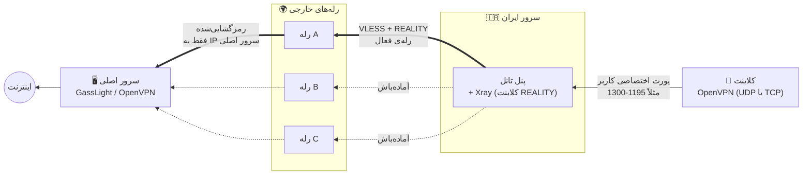
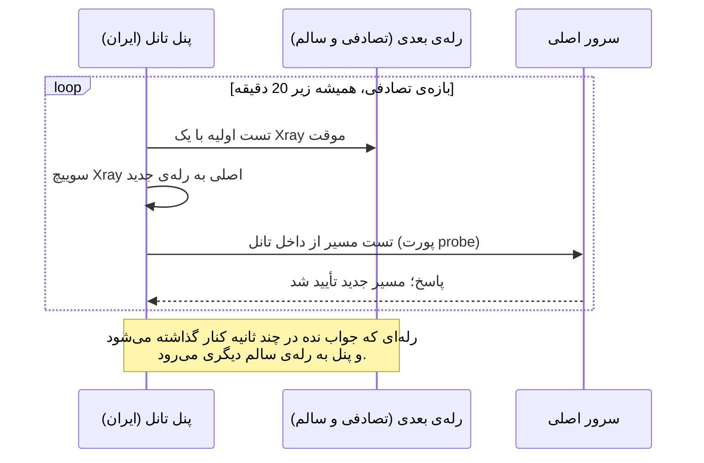

<div dir="rtl">

## 🛰️ تانل Overlay: سرور ایران ← رله‌های خارجی چرخشی ← سرور اصلی

یک شبکه‌ی overlay اختیاری برای GassLight. کاربران دیگر مستقیم به سرور اصلی وصل نمی‌شوند. آن‌ها به یک **سرور داخل ایران** وصل می‌شوند و این سرور هر اتصال را با **VLESS + REALITY** (هسته‌ی Xray) از میان یکی از چند **سرور خارجی (رله)** عبور می‌دهد. رله‌ی فعال هر چند دقیقه یک‌بار به‌صورت تصادفی عوض می‌شود. رله ترافیک را رمزگشایی می‌کند و به **سرور اصلی OpenVPN / GassLight** می‌رساند.

نتیجه: IP سرور اصلی هیچ‌وقت به کاربر یا فیلترینگ نشان داده نمی‌شود، حجم مصرفی بین چند IP پخش می‌شود و اگر یک رله بن شد، به‌جای سرور اصلی فقط یک رله‌ی ارزان را عوض می‌کنید.

**فایل‌ها** (پوشه‌ی [`overlay/`](overlay) همین ریپو)

| فایل | اجرا روی | کارکرد |
|---|---|---|
| `tunnel_panel.py` | 🇮🇷 سرور ایران | پنل کنترل تانل (Flask، تک‌فایل). Xray، رله‌ها، چرخش مسیر، بررسی سلامت و داشبورد زنده را مدیریت می‌کند (رابط فارسی و انگلیسی). |
| `overlay-panel-setup.sh` | 🇮🇷 سرور ایران | نصب‌کننده‌ی تک‌دستوری: Xray + سرویس `gl-xray` + پنل + سرویس `gl-tunnel`. در پایان یوزرنیم، پسورد و آدرس پنل را چاپ می‌کند. |
| `relay-server-setup.sh` | 🌍 هر رله‌ی خارجی | نصب‌کننده‌ی تک‌دستوری رله‌ی REALITY که **فقط** به سرور اصلی شما دسترسی دارد. لینک `vless://` را برای پنل چاپ می‌کند. |

**فهرست:** [معماری](#ov-arch) · [شیوه‌ی کارکرد](#ov-how) · [نصب گام‌به‌گام](#ov-setup) · [دستورهای کاربردی](#ov-cmds) · [نکته‌ها و محدودیت‌ها](#ov-notes) · [مرجع کامل دستورها](#ov-ref)

---

<a id="ov-arch"></a>

### معماری

<div dir="ltr">



</div>

خط‌های ضخیم، مسیری هستند که همین الان استفاده می‌شود. خط‌چین‌ها رله‌های سالمِ آماده‌باش هستند که پنل می‌تواند به آن‌ها سوییچ کند.

**چرخش مسیر (هر 8 تا 19 دقیقه، تصادفی):**

<div dir="ltr">



</div>

---

<a id="ov-how"></a>

### شیوه‌ی کارکرد

1. **کلاینت ← سرور ایران.** کاربر یک فایل `.ovpn` معمولی وارد می‌کند، ولی آدرس `remote` داخل آن **IP سرور ایران** است (در پنل اصلی تنظیم می‌شود، مرحله‌ی 4 پایین). کاربر به همان پورت اختصاصی قبلی وصل می‌شود.
2. **داخل سرور ایران.** پنل تانل یک نمونه **Xray** (سرویس `gl-xray`) را اجرا و مدیریت می‌کند. هر پورتِ عبوری (TCP و UDP) یک ورودی `dokodemo-door` در Xray است که به آدرس سرور اصلی فوروارد می‌کند. خروجی از نوع **VLESS + REALITY** (`xtls-rprx-vision` با fingerprint کروم) به سمت **رله‌ی فعال فعلی** است. برای شبکه‌ی بین ایران و رله، این اتصال شبیه یک ارتباط معمولی TLS 1.3 با یک وب‌سایت معروف دیده می‌شود.
3. **چرخش مسیر.** در یک لحظه‌ی تصادفی بین *حداقل* و *حداکثر* دقیقه (پیش‌فرض 8 تا 15، قابل تنظیم، **هرگز 20 یا بیشتر نیست**) پنل یک رله‌ی سالم دیگر را تصادفی انتخاب می‌کند، اول آن را تست می‌کند، Xray را به آن سوییچ می‌کند و بعد مسیر تا سرور اصلی را بررسی می‌کند. اگر بررسی شکست بخورد یا رله از کار بیفتد، پنل بلافاصله از آن رله خارج می‌شود. هر سوییچ در تاریخچه ثبت می‌شود.
4. **رله‌ی خارجی.** `relay-server-setup.sh` یک Xray با ورودی VLESS + REALITY نصب می‌کند که یک سایت HTTPS واقعی را تقلید می‌کند (پیش‌فرض `www.microsoft.com`). تانل را رمزگشایی می‌کند و ترافیک را به سرور اصلی می‌فرستد. قوانین مسیریابی آن فقط **IP سرور اصلی** را، فقط روی پورت‌های مجاز (پیش‌فرض `1024-65535` و هرگز SSH) و در صورت استفاده از ‎`--allow-from` فقط از IP سرور ایران اجازه می‌دهد. هر چیز دیگری مسدود می‌شود. سرویس با یک کاربر بدون دسترسی ویژه (`gl-relay`) اجرا می‌شود.
5. **سرور اصلی.** اتصال را از IP رله دریافت می‌کند. محدودیت حجم، سرعت و انقضای هر کاربر مثل قبل کار می‌کند، چون به پورت و زیرشبکه‌ی VPN هر کاربر وابسته است و نه به IP عمومی او.

**چرا این طراحی**

| هدف | چطور محقق می‌شود |
|---|---|
| پنهان‌کردن سرور اصلی | کاربر و فیلترینگ فقط سرور ایران و رله‌ها را می‌بینند |
| تاب‌آوری در برابر بن شدن | رله‌ی بن‌شده جایگزین می‌شود و IP سرور اصلی سالم می‌ماند |
| پخش حجم و کاهش شناسایی | چند IP رله و تغییر تصادفی مسیر هر چند دقیقه |
| شبیه ترافیک عادی بودن | REALITY یک وب‌سایت واقعی با TLS 1.3 / HTTP/2 را تقلید می‌کند |
| محدود کردن خسارت در صورت لو رفتن رله | رله به هیچ چیز جز پورت‌های مجاز سرور اصلی دسترسی ندارد |

---

<a id="ov-setup"></a>

### نصب گام‌به‌گام

به این‌ها نیاز دارید: یک **سرور اصلی** که GassLight روی آن در حال اجراست، یک **سرور ایران** و **یک یا چند سرور خارجی برای رله** (Debian / Ubuntu، با دسترسی root).

> لینک‌های دانلود زیر فرض می‌کنند فایل‌ها در `MahanAmini/openvpn`، شاخه‌ی `main` و پوشه‌ی `overlay/` هستند. اگر ریپوی شما فرق دارد، آدرس‌ها را اصلاح کنید.

#### گام 1: نصب پنل روی سرور ایران

فایل‌های `tunnel_panel.py` و `overlay-panel-setup.sh` را در **یک پوشه** دانلود کنید و نصب‌کننده را اجرا کنید:

<div dir="ltr">

```bash
curl -fsSLO https://raw.githubusercontent.com/MahanAmini/openvpn/main/overlay/tunnel_panel.py
curl -fsSLO https://raw.githubusercontent.com/MahanAmini/openvpn/main/overlay/overlay-panel-setup.sh
sudo bash overlay-panel-setup.sh
```

</div>

این اسکریپت Xray را (با نصب‌کننده‌ی رسمی XTLS) نصب می‌کند، سرویس `gl-xray` را می‌سازد، پایتون و Flask را نصب می‌کند، پنل را در `/opt/gl-tunnel` کپی می‌کند و آن را به‌صورت سرویس `gl-tunnel` (با اجرا در بوت) راه می‌اندازد. بعد از پایان دقیقاً این خروجی را چاپ می‌کند:

<div dir="ltr">

```
username : gasslight
password : 48210937
url      : http://203.0.113.20:8090
```

</div>

پسورد یک عدد تصادفی 8 رقمی است که **فقط یک‌بار** نمایش داده می‌شود؛ ذخیره‌اش کنید. آدرس را در مرورگر باز کنید و وارد شوید. (بعد از 5 تلاش ناموفق از یک IP، ورود به مدت 5 دقیقه قفل می‌شود.)

گزینه‌های اختیاری: ‎`--port 8090`، ‎`--password MyPass123`، ‎`--xray-zip Xray-linux-64.zip` (وقتی GitHub از روی سرور باز نمی‌شود). لیست کامل در [مرجع دستورها](#ov-ref).

#### گام 2: نصب رله روی هر سرور خارجی

روی **هر سرور خارجی که قرار است رله باشد**، `relay-server-setup.sh` را دانلود و اجرا کنید:

<div dir="ltr">

```bash
curl -fsSLO https://raw.githubusercontent.com/MahanAmini/openvpn/main/overlay/relay-server-setup.sh
sudo bash relay-server-setup.sh --main 203.0.113.5 --allow-from 198.51.100.7 --name relay-de1 --ports 1195-1300,8088,8089
```

</div>

| گزینه | معنی |
|---|---|
| ‎`--main` | IPv4 سرور **اصلی** GassLight / OpenVPN (اجباری). رله به هیچ مقصد دیگری دسترسی ندارد. |
| ‎`--allow-from` | IPv4 سرور **ایران**. فقط همین آدرس می‌تواند از رله استفاده کند. شدیداً توصیه می‌شود. |
| ‎`--name` | برچسبی که در پنل نمایش داده می‌شود. |
| ‎`--ports` | پورت‌های سرور اصلی که رله اجازه‌ی رسیدن به آن‌ها را دارد: پورت‌های کاربران، پورت probe (`8088`) و هر چیز دیگری که تانل می‌شود (مثلاً پرتال کاربر `8089`). |

در پایان لینکی شبیه این چاپ می‌شود:

<div dir="ltr">

```
vless://UUID@RELAY_IP:443?encryption=none&flow=xtls-rprx-vision&security=reality&sni=www.microsoft.com&fp=chrome&pbk=...&sid=...&type=tcp#relay-de1
```

</div>

آن را کپی کنید. هر زمان با `sudo bash relay-server-setup.sh --show` دوباره چاپ می‌شود. این گام را روی تک‌تک سرورهای رله تکرار کنید.

#### گام 3: افزودن رله‌ها و روشن کردن تانل

در پنل تانل:

1. **Relays ← Import**: هر لینک `vless://` را بچسبانید.
2. **Settings**: **آدرس سرور اصلی**، **پورت‌های عبوری** (همان پورت‌هایی که پنل اصلی به کاربران می‌دهد، پیش‌فرض `1195-1300`)، **پورت تست مسیر** (`8088`، پنل اصلی GassLight) و بازه‌ی چرخش به دقیقه را وارد کنید.
3. تانل را **روشن** کنید. **Dashboard** رله‌ی فعال، زمان سوییچ بعدی، اتصال‌های زنده و تاریخچه‌ی سوییچ‌ها را نشان می‌دهد. **Traffic** و **Log** مصرف و رویدادها را نشان می‌دهند.

#### گام 4: هدایت فایل‌های `.ovpn` به سرور ایران

در پنل **اصلی** GassLight: **Advanced ← Address inside .ovpn files** و **IP سرور ایران** را وارد کنید. فایل‌های `.ovpn` جدید (و لینک‌های پرتال کاربر) به سرور ایران وصل می‌شوند. کاربران باید یک‌بار کانفیگ را دوباره دانلود کنند.

#### گام 5: فایروال‌ها

| سرور | چه چیزی باز شود |
|---|---|
| 🇮🇷 ایران | TCP پورت `8090` (پنل)؛ **TCP و UDP** برای تک‌تک پورت‌های عبوری (مثلاً `1195-1300`) |
| 🌍 هر رله | TCP پورت `443` (یا ‎`--port` شما) |
| 🖥️ اصلی | پورت‌های کاربران (و پورت probe یعنی `8088`) باید ترافیک **IPهای رله‌ها** را بپذیرند |

هر دو نصب‌کننده در صورت فعال بودن `ufw`، پورت را خودشان باز می‌کنند. فایروال ابری و security groupها با خود شماست.

---

<a id="ov-cmds"></a>

### دستورهای کاربردی

نصب و مدیریت رله (دستورهای اصلی):

<div dir="ltr">

```bash
# نصب رله
sudo bash relay-server-setup.sh --main 203.0.113.5 --allow-from 198.51.100.7 --name relay-de1 --ports 1195-1300,8088,8089

sudo bash relay-server-setup.sh --show                                                    # چاپ دوباره‌ی لینک vless://
sudo bash relay-server-setup.sh --main 203.0.113.5 --allow-from 198.51.100.7 --regen      # uuid و کلید جدید (ورودی‌های قبلی پنل از کار می‌افتند)
sudo bash relay-server-setup.sh --uninstall                                               # حذف رله

sudo systemctl status gl-relay                                    # وضعیت رله
sudo systemctl restart gl-relay                                   # ری‌استارت رله
sudo systemctl stop gl-relay                                      # توقف رله
journalctl -u gl-relay -n 30 --no-pager                           # 30 خط آخر لاگ
cat /etc/gl-relay/link.txt                                        # لینک ذخیره‌شده
/usr/local/bin/xray run -test -config /etc/gl-relay/config.json   # تست کانفیگ رله
```

</div>

بررسی پنل سمت ایران:

<div dir="ltr">

```bash
sudo systemctl status gl-tunnel          # وضعیت پنل
journalctl -u gl-tunnel -f               # لاگ زنده‌ی پنل
sudo systemctl status gl-xray            # Xray که پنل مدیریتش می‌کند
```

</div>

---

<a id="ov-notes"></a>

### نکته‌ها و محدودیت‌ها

- هر سوییچ مسیر، **Xray را ری‌استارت می‌کند**. کاربران **UDP** یک وقفه‌ی بسیار کوتاه می‌بینند و کلاینت خودش ادامه می‌دهد. کاربران **TCP** قطع می‌شوند و کلاینت دوباره وصل می‌شود. برای کاربران پشت تانل UDP را ترجیح دهید.
- UDP داخل جریان TCP مربوط به REALITY عبور می‌کند، پس کیفیت در شرایط packet loss از اتصال مستقیم پایین‌تر است.
- سرور اصلی **IP رله** را می‌بیند، نه IP واقعی کاربر. محدودیت حجم، سرعت و انقضای هر کاربر تحت تأثیر قرار نمی‌گیرد.
- سرور ایران تنها نقطه‌ی ورود کل شبکه است. آن را سالم نگه دارید و پسورد پنل را محفوظ نگه دارید.
- پسوردی که `overlay-panel-setup.sh` چاپ می‌کند فقط بار اول استفاده می‌شود. اگر پنل از قبل ادمین داشته باشد، اجرای دوباره‌ی نصب‌کننده آن را نگه می‌دارد. پسورد را از داخل پنل عوض کنید.
- اجرای دوباره‌ی `relay-server-setup.sh` کلیدهای موجود را نگه می‌دارد. بدون ‎`--name`، برچسب به hostname سرور برمی‌گردد.

---

<a id="ov-ref"></a>

### مرجع کامل دستورها

همه‌ی دستورها به‌صورت اسپردشیت هم موجودند: [`overlay-commands.xlsx`](overlay/overlay-commands.xlsx).

#### 1. دستورهای `overlay-panel-setup.sh` (سرور ایران)

| دستور | کارکرد |
|---|---|
| ‎`sudo bash overlay-panel-setup.sh` | نصب Xray و پنل تانل، با پسورد تصادفی 8 رقمی |
| ‎`sudo bash overlay-panel-setup.sh --port N` | پورت پنل (پیش‌فرض `8090`) |
| ‎`sudo bash overlay-panel-setup.sh --password PW` | پسورد دلخواه به‌جای تصادفی (فقط نصب اول؛ حداقل 6 کاراکتر: حروف، ارقام، `. _ - @`) |
| ‎`sudo bash overlay-panel-setup.sh --panel FILE` | مسیر `tunnel_panel.py` اگر کنار اسکریپت نیست |
| ‎`sudo bash overlay-panel-setup.sh --repo-url URL` | دانلود `tunnel_panel.py` از `URL/tunnel_panel.py` |
| ‎`sudo bash overlay-panel-setup.sh --xray-zip FILE` | نصب Xray از زیپ آپلودشده (وقتی GitHub بسته است) |
| ‎`sudo bash overlay-panel-setup.sh --help` | نمایش راهنما |

#### 2. دستورهای `relay-server-setup.sh` (رله‌ی خارجی)

| دستور | کارکرد |
|---|---|
| ‎`sudo bash relay-server-setup.sh --main IP --allow-from IP` | نصب رله (`--main` سرور اصلی، `--allow-from` سرور ایران) |
| ‎`... --port N` | پورت رله (پیش‌فرض `443`) |
| ‎`... --dest HOST:PORT` | سایت HTTPS که رله تقلید می‌کند (پیش‌فرض `www.microsoft.com:443`؛ باید TLS 1.3 + HTTP/2 داشته باشد) |
| ‎`... --sni NAME` | نام سروری که کلاینت‌ها ارائه می‌دهند (پیش‌فرض: هاست `--dest`) |
| ‎`... --name NAME` | برچسب نمایش در پنل (پیش‌فرض: hostname) |
| ‎`... --ports LIST` | پورت‌های مجاز سرور اصلی (پیش‌فرض `1024-65535`؛ لیست و بازه مثل `1195-3000,8088`) |
| ‎`... --public-ip IP` | IP عمومی که در لینک نوشته می‌شود (پیش‌فرض: تشخیص خودکار) |
| ‎`... --xray-zip FILE` | نصب Xray از زیپ محلی |
| ‎`... --skip-dest-check` | سایت `--dest` را تست نکن |
| ‎`... --regen` | uuid، کلید و short id جدید (ورودی‌های قبلی پنل از کار می‌افتند) |
| ‎`... --show` | چاپ دوباره‌ی لینک `vless://` ذخیره‌شده |
| ‎`... --uninstall` | حذف رله (باینری Xray می‌ماند) |
| ‎`... --help` | نمایش راهنما |

#### 3. کنترل پنل، سرور ایران (`gl-tunnel`)

| دستور | کارکرد |
|---|---|
| ‎`sudo systemctl status gl-tunnel` | وضعیت پنل |
| ‎`sudo systemctl restart gl-tunnel` | ری‌استارت (بعد از به‌روزرسانی فایل) |
| ‎`sudo systemctl stop gl-tunnel` | توقف |
| ‎`sudo systemctl start gl-tunnel` | شروع |
| ‎`sudo systemctl disable --now gl-tunnel` | توقف و حذف از بوت |
| ‎`journalctl -u gl-tunnel -f` | لاگ زنده |

#### 4. کنترل Xray، سرور ایران (`gl-xray`)

| دستور | کارکرد |
|---|---|
| ‎`sudo systemctl status gl-xray` | وضعیت |
| ‎`sudo systemctl restart gl-xray` | ری‌استارت |
| ‎`journalctl -u gl-xray -n 30 --no-pager` | 30 خط آخر لاگ |
| ‎`/usr/local/bin/xray run -test -config /opt/gl-tunnel/xray/config.json` | تست کانفیگ |

#### 5. کنترل رله، سرور خارجی (`gl-relay`)

| دستور | کارکرد |
|---|---|
| ‎`sudo systemctl status gl-relay` | وضعیت |
| ‎`sudo systemctl restart gl-relay` | ری‌استارت |
| ‎`sudo systemctl stop gl-relay` | توقف |
| ‎`journalctl -u gl-relay -n 30 --no-pager` | لاگ |
| ‎`cat /etc/gl-relay/link.txt` | لینک ذخیره‌شده |
| ‎`/usr/local/bin/xray run -test -config /etc/gl-relay/config.json` | تست کانفیگ |

#### 6. نگهداری (سرور ایران)

| دستور | کارکرد |
|---|---|
| ‎`sudo cp tunnel_panel.py /opt/gl-tunnel/tunnel_panel.py` | جایگزینی فایل پنل |
| ‎`sudo chmod 700 /opt/gl-tunnel/tunnel_panel.py` | تنظیم دسترسی بعد از کپی |
| ‎`sudo systemctl stop gl-tunnel` | توقف قبل از ریست پسورد |
| ‎`sudo rm /opt/gl-tunnel/auth.json` | حذف ادمین‌ها (ریست پسورد) |
| ‎`sudo nano /etc/systemd/system/gl-tunnel.service` | تغییر `PANEL_PASSWORD` |
| ‎`sudo systemctl daemon-reload` | بارگذاری دوباره‌ی فایل سرویس بعد از ویرایش |
| ‎`sudo systemctl start gl-tunnel` | شروع دوباره بعد از ریست |

#### 7. حذف کامل پنل (دستی، سرور ایران)

<div dir="ltr">

```bash
sudo systemctl disable --now gl-tunnel gl-xray
sudo rm /etc/systemd/system/gl-tunnel.service /etc/systemd/system/gl-xray.service
sudo systemctl daemon-reload
sudo rm -rf /opt/gl-tunnel          # اختیاری: دیتای پنل هم پاک می‌شود
```

</div>

</div>
