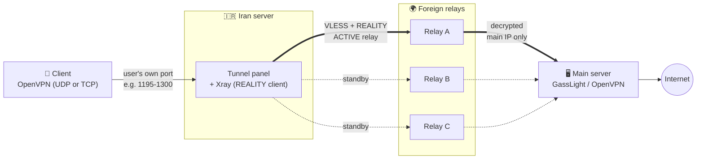
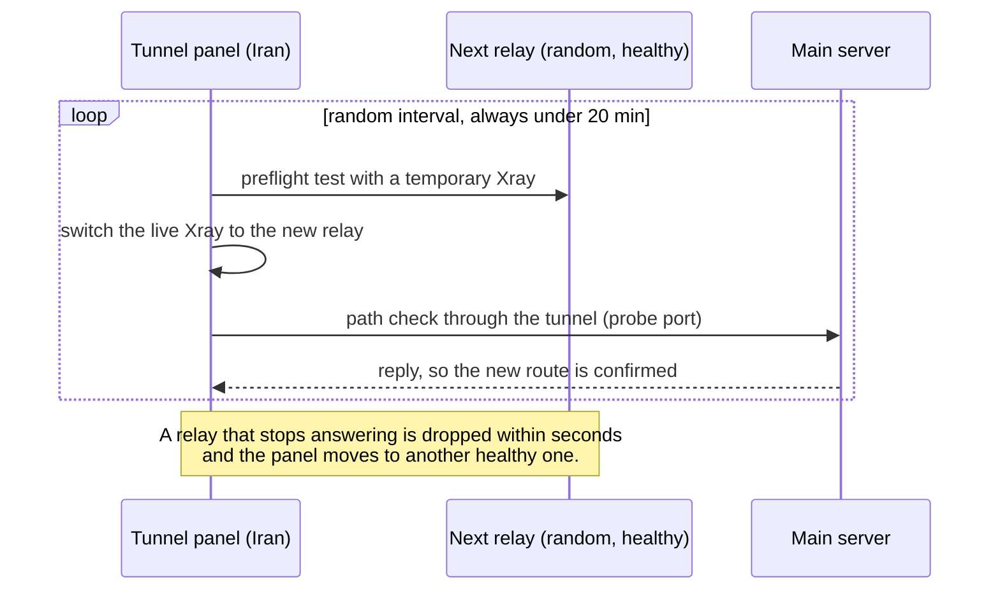

## 🛰️ Overlay Tunnel: Iran server → rotating foreign relays → main server

An optional overlay network for GassLight. Users stop connecting to the main server directly. They connect to a server **inside Iran**, which carries every connection through **VLESS + REALITY** (Xray) to one of several **foreign relay servers**. The active relay is changed at random every few minutes. The relay decrypts the traffic and hands it to the **main OpenVPN / GassLight server**.

The result: the main server's IP is never exposed to the user or to censors, traffic is spread over several IPs, and if a relay gets blocked you replace a cheap relay instead of your main server.

**Files** (folder [`overlay/`](overlay) of this repo)

| File | Runs on | What it does |
|---|---|---|
| `tunnel_panel.py` | 🇮🇷 Iran server | The tunnel control panel (Flask, single file). Manages Xray, relays, rotation, health checks and a live dashboard (English / Persian UI). |
| `overlay-panel-setup.sh` | 🇮🇷 Iran server | One-command installer: Xray + `gl-xray` service + panel + `gl-tunnel` service. Prints the panel's username, password and address. |
| `relay-server-setup.sh` | 🌍 Each foreign relay | One-command installer for a REALITY relay that can reach **only** your main server. Prints a `vless://` link for the panel. |

**Contents:** [Architecture](#architecture) · [How it works](#how-it-works) · [Step-by-step setup](#step-by-step-setup) · [Useful commands](#useful-commands) · [Notes & limits](#notes--limits) · [Full command reference](#full-command-reference)

---

### Architecture



Solid thick lines are the path in use right now. Dotted lines are healthy standby relays that the panel can switch to.

**Route rotation (every 8–19 minutes, chosen at random):**



---

### How it works

1. **Client → Iran server.** The user imports a normal `.ovpn` file, but its `remote` address is the **Iran server's IP** (set in the main panel, see step 4 below). The user connects to the same per-user port as before.
2. **Inside the Iran server.** The tunnel panel runs and manages an **Xray** instance (service `gl-xray`). Each carried port (TCP and UDP) is an Xray `dokodemo-door` inbound that forwards to the main server's address. The outbound is **VLESS + REALITY** (`xtls-rprx-vision`, Chrome fingerprint) toward the **currently active relay**. To the network between Iran and the relay the connection looks like ordinary TLS 1.3 to a well-known website.
3. **Route rotation.** At a random moment between *min* and *max* minutes (default 8 to 15, adjustable, **never 20 or more**) the panel picks another healthy relay at random, tests it first, switches Xray to it, then runs a path check to the main server. A failed check or a dead relay makes the panel leave that relay immediately. Every switch is recorded in the history.
4. **Foreign relay.** `relay-server-setup.sh` installs Xray with a VLESS + REALITY inbound that imitates a real HTTPS site (`www.microsoft.com` by default). It decrypts the tunnel and forwards the traffic to the main server. Its routing rules allow **only the main server's IP**, only on the allowed ports (default `1024-65535`, never SSH), and optionally only from the Iran server's IP (`--allow-from`). Everything else is dropped. The service runs as an unprivileged user (`gl-relay`).
5. **Main server.** Receives the connection from the relay's IP. Per-user limits, speed and expiry keep working, because they are tied to each user's port and VPN subnet, not to the user's public IP.

**Why this design**

| Goal | How it is met |
|---|---|
| Hide the main server | Users and censors only ever see the Iran server and the relays |
| Survive blocking | A blocked relay is replaced; the main server's IP stays clean |
| Spread traffic and reduce fingerprinting | Several relay IPs, random switching every few minutes |
| Look like normal traffic | REALITY imitates a real TLS 1.3 / HTTP/2 website |
| Limit damage if a relay is compromised | The relay can reach nothing except the main server's allowed ports |

---

### Step-by-step setup

You need: a **main server** already running GassLight, an **Iran server**, and **one or more foreign relay servers** (Debian / Ubuntu, root access).

> The download links below assume the files live at `MahanAmini/openvpn`, branch `main`, folder `overlay/`. Adjust them if your repository differs.

#### Step 1: Install the panel on the Iran server

Download `tunnel_panel.py` and `overlay-panel-setup.sh` into the **same folder**, then run the installer:

```bash
curl -fsSLO https://raw.githubusercontent.com/MahanAmini/openvpn/main/overlay/tunnel_panel.py
curl -fsSLO https://raw.githubusercontent.com/MahanAmini/openvpn/main/overlay/overlay-panel-setup.sh
sudo bash overlay-panel-setup.sh
```

It installs Xray (official XTLS installer), creates the `gl-xray` service, installs Python + Flask, copies the panel to `/opt/gl-tunnel`, and starts it as the `gl-tunnel` service (also enabled on boot). When it finishes it prints exactly:

```
username : gasslight
password : 48210937
url      : http://203.0.113.20:8090
```

The password is a random 8-digit number, shown **once**. Save it. Open the URL in a browser and log in. (After 5 wrong attempts from one IP the login is locked for 5 minutes.)

Optional flags: `--port 8090`, `--password MyPass123`, `--xray-zip Xray-linux-64.zip` (when GitHub is not reachable from the server). Full list in the [command reference](#full-command-reference).

#### Step 2: Install a relay on each foreign server

On **every foreign relay server**, download and run `relay-server-setup.sh`:

```bash
curl -fsSLO https://raw.githubusercontent.com/MahanAmini/openvpn/main/overlay/relay-server-setup.sh
sudo bash relay-server-setup.sh --main 203.0.113.5 --allow-from 198.51.100.7 --name relay-de1 --ports 1195-1300,8088,8089
```

| Option | Meaning |
|---|---|
| `--main` | IPv4 of the **main** GassLight / OpenVPN server (required). The relay can reach nothing else. |
| `--allow-from` | IPv4 of the **Iran** server. Only this address may use the relay. Strongly recommended. |
| `--name` | Label shown in the panel. |
| `--ports` | Ports on the main server the relay may reach: your users' ports, the probe port (`8088`) and anything else you tunnel (for example the user portal `8089`). |

At the end it prints a link like:

```
vless://UUID@RELAY_IP:443?encryption=none&flow=xtls-rprx-vision&security=reality&sni=www.microsoft.com&fp=chrome&pbk=...&sid=...&type=tcp#relay-de1
```

Copy it. Print it again any time with `sudo bash relay-server-setup.sh --show`. Repeat this step on every relay server.

#### Step 3: Add the relays and turn the tunnel on

In the tunnel panel:

1. **Relays → Import**: paste each `vless://` link.
2. **Settings**: enter the **main server address**, the **carried ports** (the same ports the main panel gives to users, default `1195-1300`), the **path-check port** (`8088`, the main GassLight panel) and the rotation range in minutes.
3. Turn the tunnel **on**. The **Dashboard** shows the active relay, the next switch time, live connections and the switch history. **Traffic** and **Log** show usage and events.

#### Step 4: Point the `.ovpn` files at the Iran server

In the **main** GassLight panel: **Advanced → Address inside .ovpn files** and enter the **Iran server's IP**. Newly downloaded `.ovpn` files (and the user portal links) will connect to the Iran server. Users must re-download their config once.

#### Step 5: Firewalls

| Server | Open |
|---|---|
| 🇮🇷 Iran | TCP `8090` (panel); **TCP and UDP** for every carried port (e.g. `1195-1300`) |
| 🌍 Each relay | TCP `443` (or your `--port`) |
| 🖥️ Main | The users' ports (and probe port `8088`) must accept traffic from the **relay IPs** |

`ufw` is opened automatically by both installers when it is active. Cloud firewalls and security groups are up to you.

---

### Useful commands

Install and manage a relay (the main commands):

```bash
# install a relay
sudo bash relay-server-setup.sh --main 203.0.113.5 --allow-from 198.51.100.7 --name relay-de1 --ports 1195-1300,8088,8089

sudo bash relay-server-setup.sh --show                                                    # print the vless:// link again
sudo bash relay-server-setup.sh --main 203.0.113.5 --allow-from 198.51.100.7 --regen      # new uuid and keys (old panel entries stop working)
sudo bash relay-server-setup.sh --uninstall                                               # remove the relay

sudo systemctl status gl-relay                                    # relay status
sudo systemctl restart gl-relay                                   # restart the relay
sudo systemctl stop gl-relay                                      # stop the relay
journalctl -u gl-relay -n 30 --no-pager                           # last 30 log lines
cat /etc/gl-relay/link.txt                                        # the saved link
/usr/local/bin/xray run -test -config /etc/gl-relay/config.json   # validate the relay config
```

Check the Iran-side panel:

```bash
sudo systemctl status gl-tunnel          # panel status
journalctl -u gl-tunnel -f               # live panel log
sudo systemctl status gl-xray            # Xray managed by the panel
```

---

### Notes & limits

- Every route switch **restarts Xray**. **UDP** OpenVPN users see a very short pause and the client carries on by itself. **TCP** users are disconnected and the client reconnects. Prefer UDP for users behind the tunnel.
- UDP travels inside the REALITY TCP stream, so quality under packet loss is lower than a direct connection.
- The main server sees the **relay's IP**, not the user's real IP. Per-user volume, speed and expiry limits are not affected.
- The Iran server is the single entry point of the whole network. Keep it healthy and keep its panel password safe.
- The password printed by `overlay-panel-setup.sh` is used only the first time. If the panel already has an admin, re-running the installer keeps it. Change passwords from inside the panel.
- Re-running `relay-server-setup.sh` keeps the existing keys. Without `--name` the label returns to the server's hostname.

---

### Full command reference

All commands are also available as a spreadsheet: [`overlay-commands.xlsx`](overlay/overlay-commands.xlsx).

#### 1. `overlay-panel-setup.sh` (Iran server)

| Command | What it does |
|---|---|
| `sudo bash overlay-panel-setup.sh` | Installs Xray and the tunnel panel, random 8-digit password |
| `sudo bash overlay-panel-setup.sh --port N` | Panel port (default `8090`) |
| `sudo bash overlay-panel-setup.sh --password PW` | Your own password instead of a random one (first install only; 6+ characters: letters, digits, `. _ - @`) |
| `sudo bash overlay-panel-setup.sh --panel FILE` | Path to `tunnel_panel.py` if it is not next to the script |
| `sudo bash overlay-panel-setup.sh --repo-url URL` | Download `tunnel_panel.py` from `URL/tunnel_panel.py` |
| `sudo bash overlay-panel-setup.sh --xray-zip FILE` | Install Xray from a zip you uploaded (when GitHub is blocked) |
| `sudo bash overlay-panel-setup.sh --help` | Show help |

#### 2. `relay-server-setup.sh` (foreign relay)

| Command | What it does |
|---|---|
| `sudo bash relay-server-setup.sh --main IP --allow-from IP` | Installs a relay (`--main` = main server, `--allow-from` = Iran server) |
| `... --port N` | Relay port (default `443`) |
| `... --dest HOST:PORT` | HTTPS site the relay imitates (default `www.microsoft.com:443`; needs TLS 1.3 + HTTP/2) |
| `... --sni NAME` | Server name clients present (default: host of `--dest`) |
| `... --name NAME` | Label shown in the panel (default: hostname) |
| `... --ports LIST` | Main-server ports the relay may reach (default `1024-65535`; lists and ranges like `1195-3000,8088`) |
| `... --public-ip IP` | Public IP written into the link (default: detected) |
| `... --xray-zip FILE` | Install Xray from a local zip |
| `... --skip-dest-check` | Do not test the `--dest` site |
| `... --regen` | New uuid, keys and short id (old panel entries stop working) |
| `... --show` | Print the saved `vless://` link again |
| `... --uninstall` | Remove the relay (the Xray binary is kept) |
| `... --help` | Show help |

#### 3. Panel control, Iran server (`gl-tunnel`)

| Command | What it does |
|---|---|
| `sudo systemctl status gl-tunnel` | Panel status |
| `sudo systemctl restart gl-tunnel` | Restart (after updating the file) |
| `sudo systemctl stop gl-tunnel` | Stop |
| `sudo systemctl start gl-tunnel` | Start |
| `sudo systemctl disable --now gl-tunnel` | Stop and remove from boot |
| `journalctl -u gl-tunnel -f` | Live log |

#### 4. Xray control, Iran server (`gl-xray`)

| Command | What it does |
|---|---|
| `sudo systemctl status gl-xray` | Status |
| `sudo systemctl restart gl-xray` | Restart |
| `journalctl -u gl-xray -n 30 --no-pager` | Last 30 log lines |
| `/usr/local/bin/xray run -test -config /opt/gl-tunnel/xray/config.json` | Validate the config |

#### 5. Relay control, foreign server (`gl-relay`)

| Command | What it does |
|---|---|
| `sudo systemctl status gl-relay` | Status |
| `sudo systemctl restart gl-relay` | Restart |
| `sudo systemctl stop gl-relay` | Stop |
| `journalctl -u gl-relay -n 30 --no-pager` | Log |
| `cat /etc/gl-relay/link.txt` | The saved link |
| `/usr/local/bin/xray run -test -config /etc/gl-relay/config.json` | Validate the config |

#### 6. Maintenance (Iran server)

| Command | What it does |
|---|---|
| `sudo cp tunnel_panel.py /opt/gl-tunnel/tunnel_panel.py` | Replace the panel file |
| `sudo chmod 700 /opt/gl-tunnel/tunnel_panel.py` | Set permissions after copying |
| `sudo systemctl stop gl-tunnel` | Stop before resetting the password |
| `sudo rm /opt/gl-tunnel/auth.json` | Delete the admin accounts (password reset) |
| `sudo nano /etc/systemd/system/gl-tunnel.service` | Change `PANEL_PASSWORD` |
| `sudo systemctl daemon-reload` | Reload the service file after editing |
| `sudo systemctl start gl-tunnel` | Start again after the reset |

#### 7. Remove the panel completely (manual, Iran server)

```bash
sudo systemctl disable --now gl-tunnel gl-xray
sudo rm /etc/systemd/system/gl-tunnel.service /etc/systemd/system/gl-xray.service
sudo systemctl daemon-reload
sudo rm -rf /opt/gl-tunnel          # optional: also deletes the panel's data
```
